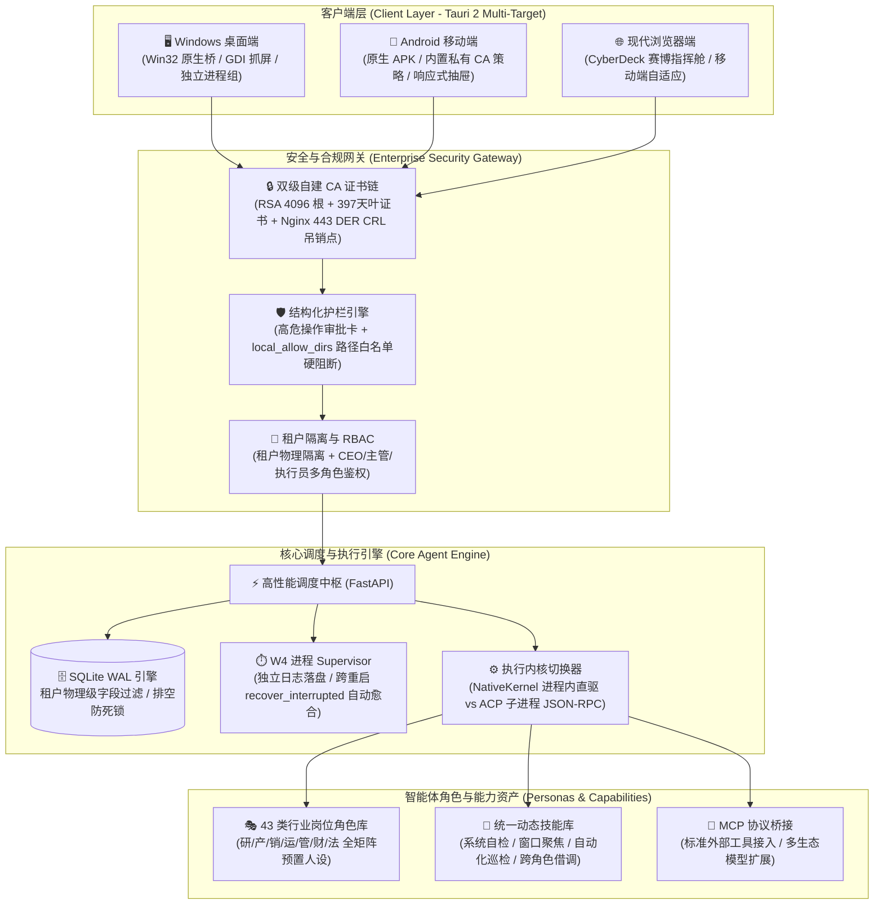

<div align="center">

# 🤖 AgentOS (OA Agent) · 次世代企业级自主智能体操作系统

**多端全双工协同 · 43 类行业岗位角色 · 动态技能组合 · 桌面原生执行桥 · 金融级安全信道 · 自备主机私有化**

<p align="center">
  
  
  
  
  
  
</p>

<p align="center">
  一句话下达业务需求 ➔ 智能拆解阶段与 WBS 任务 ➔ 生成可执行判据 ➔ 双内核精准调度 ➔ L0/L1/L2 分层严格验收 ➔ 组织经验自动沉淀
</p>

---

</div>

## 📑 目录导航

- [✨ 核心设计理念](#-核心设计理念)
- [🖼️ 界面全景与真实运行效果](#️-界面全景与真实运行效果)
  - [1. 43 类标准化角色库与岗位定制](#1-43-类标准化角色库与岗位定制)
  - [2. 动态技能库与智能助手赋能](#2-动态技能库与智能助手赋能)
  - [3. 跨端全双工协同（Windows 桌面端 + Android 移动端）](#3-跨端全双工协同windows-桌面端--android-移动端)
  - [4. 结构化高危审批卡与目录白名单硬阻断](#4-结构化高危审批卡与目录白名单硬阻断)
  - [5. 桌面原生抓屏与无损视觉闭环](#5-桌面原生抓屏与无损视觉闭环)
- [🏛️ 系统架构全景拓扑](#️-系统架构全景拓扑)
- [🚀 六大核心技术支柱](#-六大核心技术支柱)
- [⚖️ 执行内核与 FinOps 预算管控](#️-执行内核与-finops-预算管控)
- [🏁 快速开始与部署指南](#-快速开始与部署指南)
- [🛡️ 质量保证与测试套件](#️-质量保证与测试套件)
- [📂 仓库工程结构](#-仓库工程结构)

---

## ✨ 核心设计理念

传统的 AI Agent 系统往往停留在“网页聊天框内套 Prompt”的玩具阶段，面临**无法触达本地物理设备**、**缺乏权限与目录安全管控**、**跨端协同脱节**、**模型自评自嗨缺乏可验证判据**等工业级痛点。

**AgentOS** 采用**第一性原理**从底层重构企业级智能体运行基座：
1. **角色即岗位，技能即装备**：内建 43 类深度行业角色，助手创建自动继承专属岗位 Prompt 与基础工具集，详情支持按需动态扩展与跨角色技能借调。
2. **多端状态一致性（Continuum）**：电脑端下达任务，手机端即时查看与追加；手机端在通勤碎片时间发起的长链路任务，电脑桌面无缝接管并调度原生环境。
3. **安全严苛护栏（Guardrails First）**：绝不放任大模型裸奔执行危险命令。结构化变更预览审批卡 + 目录白名单硬隔离 + L0/L1/L2 证据留痕验收，彻底筑牢企业数字资产底线。
4. **金融级真实安全信道（Enterprise TLS）**：自建两级私有 CA 链与 443 端口 DER CRL 实时吊销点，完美适配 Windows Schannel 底层安全机制，彻底摒弃 `--ignore-certificate-errors` 的妥协做法。
5. **算力与数据主权去中心化（BYOH）**：账号与计算主机解耦，企业或个人自带 VPS，实现“一人一机、各用各服、数据主权完全私有”。

---

## 🖼️ 界面全景与指挥舱视图

> 界面均采用无侵入式自研组件与现代化响应式设计，严守数据隔离与合规红线。

| 赛博指挥舱：阶段流水线一览 | 总装流水线：单项目推进与交付 |
|:---:|:---:|
|  |  |

| 任务中心：判据制定与执行留痕 | FinOps：Token 折算与预算熔断池 |
|:---:|:---:|
|  |  |

| 经验沉淀：组织经验自动汇聚与转正 | 评测中心：离线回归与判据全量覆盖 |
|:---:|:---:|
|  |  |

---

### 🛡️ 结构化审批卡与护栏样式规范

```text
┌────────────────────────────────────────────────────────────────────────┐
│  ⚠️ 高风险操作审批 (Risk Level: HIGH)                                  │
├────────────────────────────────────────────────────────────────────────┤
│  操作类型: local_write                                                 │
│  目标路径: C:\Users\Admin\Documents\report.txt (4 行 / 120 字节)       │
│  变更摘要: 正在向本地白名单目录写入数据分析汇总报告                    │
├────────────────────────────────────────────────────────────────────────┤
│  [变更预览]                                                            │
│  + # 季度经营分析数据汇总                                               │
│  + Total Revenue: ¥1,280,000 (+14.2% YoY)                              │
├────────────────────────────────────────────────────────────────────────┤
│  [ local_allow_dirs 校验通过: 白名单放行 ]   [ 🚫 拒绝 ]   [ ✅ 允许执行 ] │
└────────────────────────────────────────────────────────────────────────┘
```
* **风险徽标判定**：系统根据操作危险度标注低/中/高风险，杜绝盲批；
* **目录白名单硬拦截**：未在 `local_allow_dirs` 登记的系统路径（如 `C:\Windows\Temp`）服务端直接静默阻断，无需弹窗。

---

## 🏛️ 系统架构全景拓扑



---

## 🚀 六大核心技术支柱

### 1. 43 类行业岗位角色库 × 动态技能组合系统
* **拒绝千篇一律的通用对话**：系统内置 43 个细分行业角色标准定义，涵盖技术研发、跨境电商、财税合规、内容运营、敏捷项目、销售商务等。
* **岗位创建即赋能**：新建助手时选择角色，系统自动为其初始化岗位核心 Prompt、能力标签与专属基础技能（持久化于 `bot_skills` 表）。
* **自由扩展与跨角色借调**：助手详情面板支持直观增删技能，提供本角色推荐技能库，并支持从其它 42 个角色中按需借调专属技能。

### 2. 全双工跨端协同（Windows Desktop + Android Mobile）
* **Tauri 2 统一架构**：桌面与移动端共享同一套响应式 React 前端，桌面端编译为轻量 Win32 原生可执行文件，移动端直接输出原生 Android APK。
* **移动端抽屉自适应交互**：手机端内置顶部导航、双向侧滑抽屉（`☰` 历史会话管理 + `⚙` 助手人设与技能调优），适配移动端虚拟键盘与底部安全区（Safe-Area）。
* **多端任务连续体**：无论在电脑端还是手机端下达指令，任务状态、阶段进度、产物引用均全网秒级同步，支持 PC 端发起、手机端外出审阅批复。

### 3. 桌面原生执行桥（Desktop Native Bridge）
* **Win32 深度硬件交互**：通过 Windows API 实现前台活动窗口枚举与聚焦、多屏坐标计算。
* **超轻量原生抓屏**：利用 Win32 GDI 配合纯 Rust `png` 无损压缩算法抓屏，381ms 极速生成，规避重量级依赖。
* **W4 进程 Supervisor**：
  * 支持 POSIX `setsid` 与 Windows `CREATE_NEW_PROCESS_GROUP` 隔离会话；
  * 日志独立写盘至 `<workspace>/logs/<id>.log`，坚决不使用 PIPE 避免管道未读死锁；
  * 服务启动时自动执行 `recover_interrupted`，将遗留进程标识为 `lost`，杜绝孤儿进程与假死状态。

### 4. 企业级严格护栏与人机共治（Guardrails & HITL）
* **三层可信验收标准**：
  * **L0 规则自动判定**：语法校验、状态码检查、格式匹配；
  * **L1 人工签批强制留痕**：审批人必须填写 `evidence_snippet` 凭据，**严禁大模型自评通过**；
  * **L2 沙箱脚本真实执行**：在隔离沙箱中跑自动化判据脚本，真实退出码作为唯一通过证据。
* **结构化高危审批卡**：直观展示操作对象人话摘要、目标窗口、写入内容前缀、增减字符量与高危操作原文，消灭“盲批”隐患。
* **目录白名单硬阻断**：服务端全局配置 `local_allow_dirs`，越界路径静默拦截拒绝，不给任何越权穿透机会。

### 5. 金融级真证书安全链（Enterprise TLS / CDP / CRL 吊销）
* **拒绝任何不安全的妥协**：客户端彻底移除 `--ignore-certificate-errors` 启动参数。
* **2 级自建私有 CA 体系**：RSA 4096 位根证书（有效期 10 年）+ RSA 2048 位叶证书（有效期 397 天），SAN 覆盖全内网与公网 IP。
* **适配 Windows Schannel 强吊销检查**：叶证书内嵌 CDP（CRL 分发点），配合 Nginx 443 端口发布 DER 格式 CRL 吊销列表，经真实吊销演练验证，完全通过 Schannel 与 curl 的严格握手校验。

### 6. 去中心化自备主机（BYOH - Bring Your Own Host）
* **数据主权私有化**：服务端主机与平台账号物理解耦。企业与个人用户自备 Linux VPS 或本地服务器，无需将企业机密数据集中存放在公有云。
* **极简一键拉起**：支持反向拉取架构，用户在服务器终端执行一行安装脚本即可完成环境准备与容器拉起。
* **客户端多实例管理**：客户端内置动态服务器切换器，一键无缝在“官方开发机”、“企业专属云”与“局域网私有机”之间平滑切换。

---

## ⚖️ 执行内核与 FinOps 预算管控

系统提供双内核架构，支持根据任务重要级别与预算策略动态切换：

| 内核模式 (RUNNER) | 通信机制 | 预算闸门与消耗控制 | 适用场景 |
|---|---|---|---|
| **`mock`**（默认测试） | 进程内直接调度 | 开跑前整笔预扣（消耗 0） | 单元测试、CI 流水线、逻辑自检 |
| **`mock_acp`** | JSON-RPC (Mock 服务端) | 开跑前预扣 + 越线实时取消（消耗 0） | 协议层兼容性测试 |
| **`dsh`** | 子进程 `dsh --profile headless` | 开跑前整笔预扣（黑盒模型，中途无法中断） | 离线批量无交互任务 |
| **`acp`** ⭐ (生产推荐) | `dsh --profile acp` 双向 JSON-RPC | **每次工具调用后推算用量，一旦越线立即触发 `session/cancel` 熔断** | 企业生产实盘任务、预算敏感场景 |

> **FinOps 双口径核算**：任务消耗（`task_runs.usage_tokens`）与阶段 Overhead（立项、研讨、WBS 拆解等管理调度调用）分列计算，并在阶段达 80% 预算线时前置预警熔断，按实时人民币汇率折算账单。

---

## 🏁 快速开始与部署指南

### 1. 启动服务端 (FastAPI)

```powershell
# 1. 准备 Python 虚拟环境与依赖
python -m venv .venv
.\.venv\Scripts\Activate.ps1
pip install -r requirements.txt

# 2. 生成会话加密密钥并写入 .env
$secret = python -c "import secrets; print(secrets.token_hex(32))"
Copy-Item .env.example .env
(Get-Content .env) -replace "UI_SESSION_SECRET=.*", "UI_SESSION_SECRET=$secret" | Set-Content .env

# 3. 初始化超级管理员令牌并启动服务
python tools/auth_admin.py issue --name admin --role ceo
python -m uvicorn app.main:app --host 0.0.0.0 --port 8077
```

### 2. 编译并运行 Windows 桌面端

```powershell
cd desktop
npm install

# 编译前端静态产物并生成 Tauri Windows 客户端
npm run build:tauri
npx tauri build --no-bundle
# 生成产物：desktop/src-tauri/target/release/agentos-desktop.exe
```

### 3. 云端一键构建 Android 移动端 APK

无需在本地配置繁杂的 Android Studio 与 NDK 工具链，代码仓库已内置 **GitHub Actions** 自动化移动构建流水线：

1. 将代码推送到 GitHub 仓库；
2. 访问 GitHub 仓库页面 ➔ **Actions** ➔ 选择 **Build Android APK (Tauri 2 Mobile)**；
3. 点击 **Run workflow**，流水线将自动完成 Rust 交叉编译、私有根 CA 安全策略注入与 Gradle 原生打包；
4. 在构建完成的页面底部 **Artifacts** 区域即可一键下载 `AgentOS-Android-APK` 安装包使用。

---

## 🛡️ 质量保证与测试套件

我们坚持“测试先于交付”的严谨工程原则。全仓库涵盖 **89 个专业测试文件**，覆盖权限、调度、护栏、事件、进程以及跨平台 API：

```powershell
# 运行全量自动化测试
.\.venv\Scripts\pytest.exe -q
```

**测试执行结果**：
```text
........................................................................ [  8%]
........................................................................ [ 17%]
........................................................................ [ 26%]
........................................................................ [ 35%]
........................................................................ [ 43%]
........................................................................ [ 52%]
........................................................................ [ 61%]
........................................................................ [ 70%]
........................................................................ [ 78%]
........................................................................ [ 87%]
........................................................................ [ 96%]
...............................                                          [100%]
823 passed, 1 warning in 461.40s
```
> **100% 通过（823 passed）**，无一挂起，无一报错。

---

## 📂 仓库工程结构

```text
oaagent-m0/
├── app/                      # 后端核心业务层
│   ├── agent/                # 循环 Agent 核心与工具调用链
│   ├── api_v1/               # v1 统一对外 API (Bot/会话/设备/流式/角色/技能)
│   ├── computer/             # 桌面操控与交互抽象层
│   ├── local_bridge.py       # 本地硬件与网络网关接入
│   ├── local_policy.py       # 结构化护栏与目录白名单安全策略判定
│   ├── processes.py          # W4 跨平台进程 Supervisor
│   ├── rbac.py               # 租户隔离与角色权限访问控制
│   └── events.py             # 全局流式事件总线 (SSE/WebSocket)
├── desktop/                  # 跨平台客户端 (Tauri 2 多目标架构)
│   ├── src/                  # React + Vite 响应式前端 (自适应桌面与手机)
│   ├── src-tauri/            # Rust 宿主内核 (Win32 本地桥 / Android 移动入口)
│   └── ca.crt                # 预签发私有根证书 (自动注入移动端 APK)
├── deploy/                   # 部署与运维配置
│   ├── tls/                  # 两级私有 CA 根生成与 CRL 吊销发布脚本
│   └── nginx.conf            # Nginx 443 SSL 反向代理与证书分发配置
├── docs/                     # 设计文档与媒体资源
│   ├── screenshots/          # 系统最新真机全景截图画廊
│   └── design/               # TLS.md / 护栏设计 / 架构规格说明书
├── tests/                    # 89 个全面回归测试套件 (822 条用例)
├── tools/                    # 运维与管理员辅助工具 (auth_admin.py 等)
└── .github/workflows/        # GitHub Actions CI/CD 自动化流水线
    └── build-android.yml     # Android 原生 APK 云端打包流水线
```

---

<div align="center">
  <sub>AgentOS · 次世代企业级自主智能体操作系统 · 保障数据主权与物理安全底线</sub>
</div>
