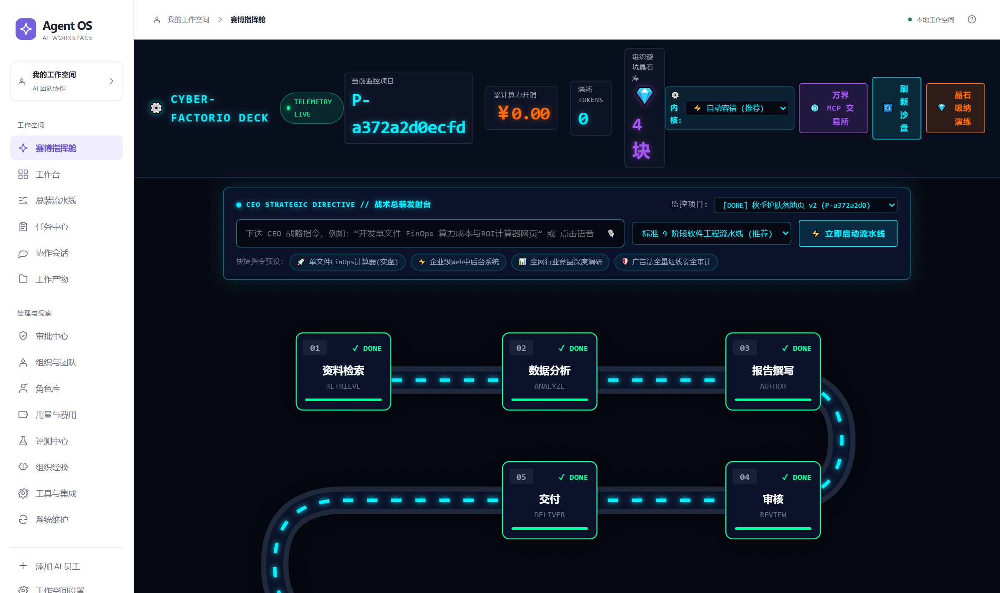
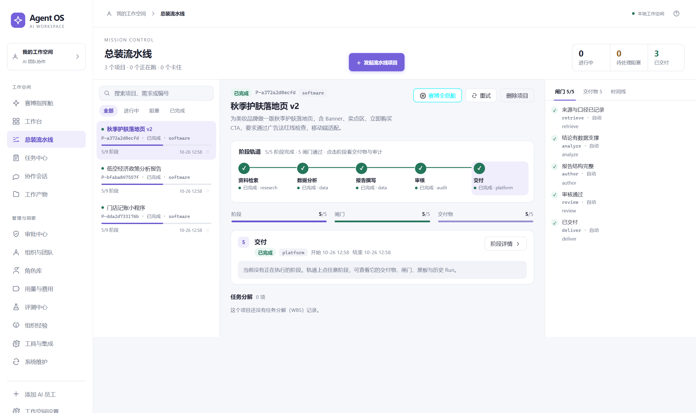
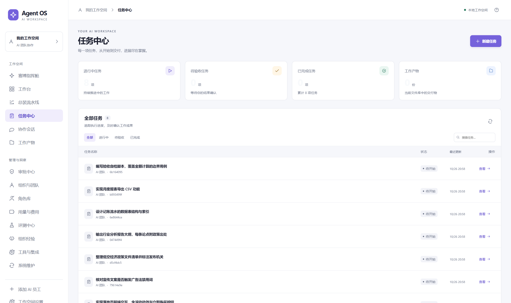
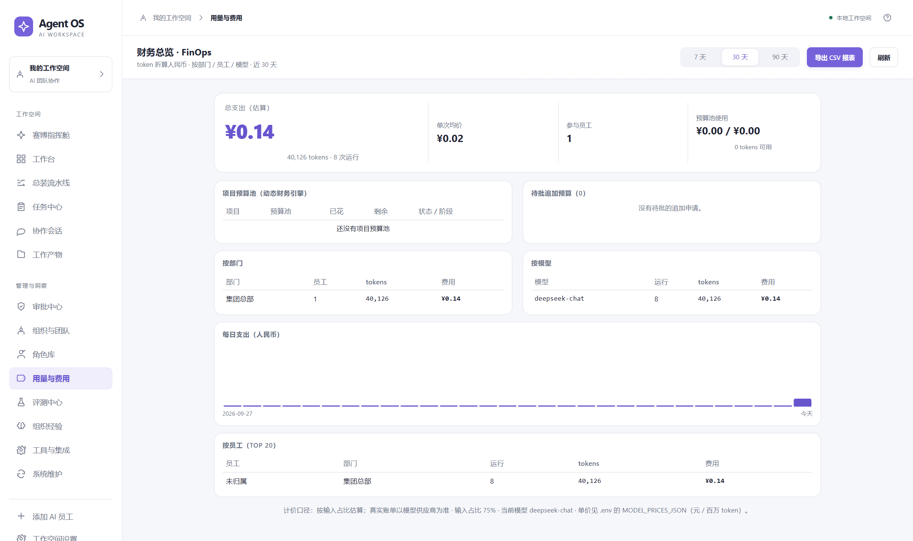
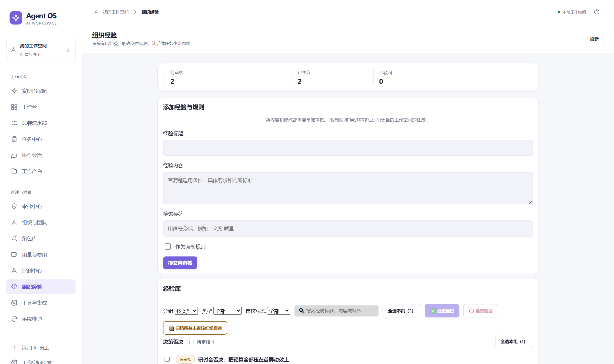
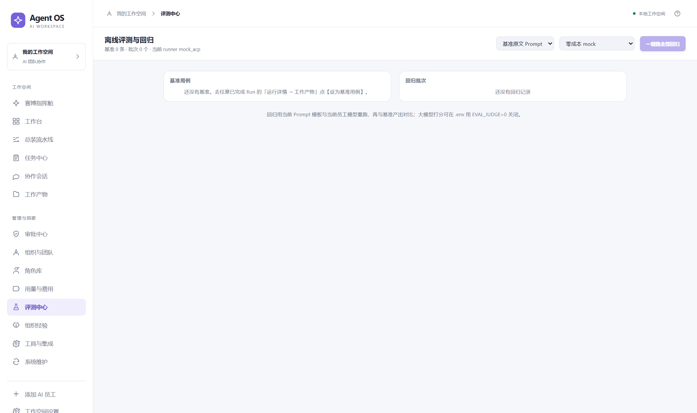

# OA Agent · M0 — Agent OS

一句话下需求 → 拆阶段与 WBS → 生成可执行判据 → 双内核执行 → L0/L1/L2 分层验收 → 审计回放 → 经验沉淀。
外壳是 FastAPI + SQLite（WAL 单写），前端是 React + Vite（可选 Tauri 桌面壳）。

当前版本 **v5.4.2**：649 条自动化用例，连续两轮全量 + 一个干净 checkout 复跑全部通过。

## 界面

> 截图取自 v5.4.2 桌面端（1600×950 视口），数据为合成演示数据。

| 赛博指挥舱：阶段流水线一览 | 总装流水线：单项目阶段推进 |
|---|---|
|  |  |

| 任务中心：任务 / 判据 / 运行记录 | FinOps：token 折算人民币与预算池 |
|---|---|
|  |  |

| 组织经验治理：待审 / 生效 / 已驳回，支持分组批量审核 | 评测中心：离线回归与判据覆盖 |
|---|---|
|  |  |

v5.x 相比 3.x 的主要变化：

- **分层验收**：L0 规则自动判定 / L1 人工签批（必须给 evidence_snippet）/ L2 沙箱脚本真实执行，
  三层证据全部落库，**模型不能自评通过**。
- **双内核执行**：`NativeKernel`（进程内工具调用，带真模型双模）与 ACP（JSON-RPC 子进程）可切换，
  `task_runs.runner` 记录真实内核，不靠猜。
- **租户与法人实体隔离**：项目、任务、运行、产物、经验、评测集按 `tenant_id` 物理过滤。
- **FinOps 双口径**：任务消耗（`task_runs.usage_tokens`）与阶段 overhead（立项/研讨/WBS/复盘等
  `llm.complete` 调用）分列统计，阶段 80% 预算检查同时覆盖两者。
- **经验闭环**：驳回 / 共识 / 否决 / 复盘自动沉淀，人工审核转正，注入前做标记剥离防「套娃污染」。
- **可复现的稳定性**：后台线程绑定发起时的数据库并登记排空，测试之间不互相踩库。

其它文档：[设计缺陷台账](DESIGN_GAPS.md) · [部署](DEPLOY.md) · [工具接入](docs/EXTENSIONS.md) ·
[封版记录 v5.4.2](SEAL_v5.4.2.md)

## 快速开始

```powershell
python -m venv .venv
.\.venv\Scripts\python.exe -m pip install -r requirements.txt
npm --prefix web ci
npm --prefix web run build
Copy-Item .env.example .env
.\.venv\Scripts\python.exe -c "import secrets; print(secrets.token_hex(32))"
# 将上一步输出写入本机 .env 的 UI_SESSION_SECRET，再启动服务。
.\.venv\Scripts\python.exe tools/auth_admin.py issue --name ceo-local --role ceo
# 保存输出的身份 ID 和 secret，供本机登录使用。
.\.venv\Scripts\python.exe -m uvicorn app.main:app --host 127.0.0.1 --port 8077
# 打开 http://127.0.0.1:8077/app/，使用该身份登录。
```

示例配置默认使用 mock 执行，不需要模型 Key。真实 DSH 执行需另外安装并配置 DSH，在本机 `.env` 填入模型 Key、设置 `UI_RUNNER=acp`，并确认 `tools/dsh-acp.patch.yml` 的供应商和模型与自己的服务匹配。模型 Key 与身份 secret 均不应提交到仓库。

也可使用 uv 建立环境：

```bash
uv venv --python "C:/Users/<you>/.dsh/dsh-runtimes/dsh-primary-runtime/dependencies/python/python.exe" .venv
uv pip install --python .venv/Scripts/python.exe -r requirements.txt
```

## 跑一次完整链路

> 本机装了代理（127.0.0.1:7890）。`curl` 默认会连 localhost 也走代理，返回 502 或空 body，
> 所以每条命令都带 `--noproxy '*'`；Python 侧用 `httpx.Client(trust_env=False)`。

```bash
# 1. 一句话建任务
curl -s --noproxy '*' -X POST localhost:8077/tasks/from_sentence -H 'content-type: application/json' \
  -d '{"text":"写一篇 500 字秋季护肤短文"}'

# 2. 起 run（注意 run_seq）
curl -s --noproxy '*' -X POST localhost:8077/verbs/spawn_run -H 'content-type: application/json' \
  -d '{"task_id":"T-...","run_seq":1}'

# 3. 执行（runner=mock 不花 token；runner=dsh 走真模型）
curl -s --noproxy '*' -X POST localhost:8077/runs/RUN-.../execute -H 'content-type: application/json' \
  -d '{"runner":"mock"}'

# 4. 跑 L0/L2 验收
curl -s --noproxy '*' -X POST localhost:8077/tasks/T-.../acceptance/run

# 5. 看时间轴
curl -s --noproxy '*' localhost:8077/tasks/T-.../timeline
```

## 执行器

| RUNNER | 传输 | 预算闸 | 花费 |
|---|---|---|---|
| `mock`（默认） | 子进程 + JSONL | 开跑前整笔预扣 | 0 |
| `mock_acp` | JSON-RPC（mock 服务端） | 开跑前预扣 + 越线取消 | 0 |
| `dsh` | `dsh --profile headless --json -`，任务走 stdin | 开跑前整笔预扣（黑盒，看不到中途用量） | 真实 token |
| `acp` | `dsh --profile acp`，JSON-RPC 双向 | 开跑前预扣 + **每次调用后越线即 `session/cancel`** | 真实 token |

ACP 是"管钱"的那条路：`usage_update` 每调用一次推一次，外壳按 `baseline + 预留` 判定，
越线立刻取消，本轮后续调用不再发生。**超支上限 = 一次调用**（已飞出去的那次拦不住），
实测 cap=2000 在 9264 处停下。零超支要等插件层的 `agent/request` 钩子，见 DESIGN_GAPS §13。

跑某一次的预算可以逐次指定，不用改环境变量：

```bash
curl -s --noproxy '*' -X POST localhost:8077/runs/RUN-.../execute -H 'content-type: application/json' \
  -d '{"runner":"acp","prompt":"...","budget_tokens":3000}'
```

`.env` 由 `app/config.py` 在启动时读入 `os.environ`（真实环境变量优先），
这样 `uvicorn app.main:app` 拉起的 `dsh` 子进程一定能拿到 `DEEPSEEK_API_KEY`。

## 业务包与审计报表（M4）

业务包（`packs` 表）决定一套判据模板和默认预算：

| 包 | 模板 | 默认预算 | 用于 |
|---|---|---|---|
| `content-v1` 内容营销包 | content | 25k | 文案、文章、投放素材 |
| `code-v1` 代码交付包 | code | 30k | 脚本、工具、自动化 |
| `review-v1` 质检评审包 | review | 45k | 对他人产出做评审 |
| `finance-v1` 财务审核包 | finance | 30k | 费用审核、对账、报销复核 |

建任务时可以显式指定 `pack_id`，不指定则按句子推断。

```bash
# 报表：按实体 / 身份 / 业务线统计 token、产出、成功率
curl -s --noproxy '*' 'localhost:8077/reports/usage?pack=finance-v1'   # 需签名
curl -s --noproxy '*' localhost:8077/packs
```

返回 `totals`（任务数、状态分布、任务成功率、run 成功率、token、产出数）、
`by_pack`、`by_identity`、`decisions`（待审/已批/已驳与金额）。

## 企业微信接入（M6）

董事长在企微里说话、点卡片，外壳不用改一行 —— 中间件只调已有 API。

```
企微 ──回调──▶ /wecom/callback（验签 + AES 解密）
                    │
                    ├─ 文字 → 建任务 API（用绑定身份签名）
                    └─ 卡片按钮 → 验收 / 审批 API
后台 watcher ──每 2s 扫库──▶ pending_review 任务、escalated_ceo 决策 ──▶ 推卡片
```

| 文件 | 职责 |
|---|---|
| `app/wecom/crypto.py` | 企微签名（sha1）+ AES-256-CBC 信封，含 corp_id 校验 |
| `app/wecom/client.py` | access_token 缓存、text / template_card 发送；mock 走本地 outbox |
| `app/wecom/bridge.py` | UserID→Identity 映射、一句话建任务、卡片构造、按钮分发 |
| `app/wecom/watcher.py` | 轮询数据库推卡片，`wecom_pushes` 账本保证只推一次 |
| `app/wecom/api.py` | `/wecom/callback`、`/wecom/simulate`、`/wecom/bind`、`/wecom/outbox` |

卡片刻度：任务卡按钮 `accept:<task_id>` / `detail:<task_id>`；审批卡 `approve:<id>` /
`reject:<id>` / `detail:decision:<id>`。点击后立刻调对应 API 并回一条文字结果。

### 本地 mock（现在就能跑）

`.env` 里 `WECOM_MOCK=1`，发送不出去、只落 `wecom_outbox`，其余链路全真：

```bash
python scripts/wecom_selfcheck.py                     # 体检
curl -X POST localhost:8077/wecom/simulate -H "X-Wecom-Token: $TOK"      -d '{"userid":"demo-user","text":"写一篇 400 字的秋季护肤短文"}'
curl -X POST localhost:8077/wecom/simulate/event -H "X-Wecom-Token: $TOK"      -d '{"userid":"demo-user","event_key":"accept:T-xxxx"}'
python scripts/wecom_card_preview.py                  # 生成卡片预览 docs/wecom_cards.html
```

### 接真实企微

1. 管理后台 → 应用管理 → 自建应用，拿 `CorpID`、`AgentId`、`Secret`
2. 接收消息 → 设置 API 接收：URL 填公网地址 + `/wecom/callback`，生成 `Token` 与
   `EncodingAESKey`（43 位）
3. 填进 `.env`：`WECOM_CORP_ID / WECOM_AGENT_ID / WECOM_SECRET / WECOM_TOKEN /
   WECOM_AES_KEY / WECOM_CALLBACK_URL`，把 `WECOM_MOCK` 改 0
4. 穿透：`ngrok http 8077` 或 natapp，把公网 URL 填回第 2 步
5. 绑定身份（企微 UserID → 系统身份）：
   `python tools/wecom_bind.py --user <企微UserID> --identity ID-da610f30a4e94e0d --name 董事长`
6. `python scripts/wecom_selfcheck.py` 全绿即通

## 工作台（Web UI）

`http://127.0.0.1:8077/` 是单页工作台（浏览器里用你的身份密钥做 HMAC 签名，不绕过 API）：

- **董事长看板**：Token 总量、任务数、成功率、产出数；各业务线消耗表；待审决策包（同意 / 驳回）
- **调度看板**：状态分布、任务列表、一键「验收」/「打回重做」
- **任务详情**：判据逐条人工判定、产出与审计时间轴

旧的单任务验收页保留在 `/review`。

## 调度与并发（M3）

- `GET /tasks?state=&actor=&limit=&offset=`：按实体分页，附带各状态计数，调度用。
- `GET /locks`：当前持有的运行锁（`task:<id>` / `session:<id>`）。
- 执行前抢锁，结束释放；抢不到返回 **409**（`TaskLocked` / `SessionLocked`），
  不会先拉起 DSH 再失败。锁带 TTL（`M0_LOCK_TTL`，默认 1800s），过期可被抢占并记审计。

## 双 Agent 接力

```bash
curl -s --noproxy '*' -X POST localhost:8077/relay/run -H 'content-type: application/json' -d '{
  "text": "写一个 Python 脚本抓取 https://example.com",
  "coder_identity_id": "ID-…", "reviewer_identity_id": "ID-…", "runner": "acp"}'
```

外壳按顺序派单：编码 Agent 建任务并跑 → 产出**复制**到审查 Agent 自己的 workspace（`input.py`）→
审查 Agent 跑测试、写 `review.md` → 各自跑验收。两个 run 各有自己的身份、目录、预算、session，
锁保证它们不会同时驱动同一条 DSH session。

## 多 Agent 隔离（M2：租户 / 资源 / 记忆）

- **租户**：实体来自签名身份，不来自请求体。别家的任务/决策/审计一律 404（不是 403，避免探存在）。
  只有 `system` 能显式跨实体（运维用）。
- **资源**：每个 Agent 独立沙箱目录 `workspace/<identity_id>/<task_id>/`，
  独立预算行（`budgets.identity_id`），一个 Agent 烧光额度不影响另一个。
- **记忆（F2）**：`memory_entries.scope` 支持 `global` / `entity:<id>` / `pack:<id>` /
  `entity:<id>:pack:<id>`；读取只返回自己实体 + 自己 pack + 全局，
  写别家作用域直接 400。

```bash
# 读自己可见的记忆
curl -s --noproxy '*' localhost:8077/memory ...（需签名，见 tools/oa_client.py）
```

## 身份与签名（M1）

所有 API 必须带 HMAC 签名（`X-OA-Key/Ts/Nonce/Sig`），未签名 401、伪造 401、重放 401。
身份决定权限：`agent` 能建任务和跑六动词，但**不能**判验收、**不能**拍板；
`manager` 批主管级决策；`ceo` 批 CEO 级决策。`decided_by` / `checked_by` 一律取签名身份。
细节见 `docs/auth.md`，脚本用 `tools/oa_client.py`。

```bash
python tools/auth_admin.py issue --name ceo-01 --role ceo   # secret 只打印一次
python tools/auth_admin.py list
```

## 沙箱：任务专属目录 + OS 级只读隔离

每个任务在自己的 `workspace/<task_id>/` 里跑，DSH 进程被降到 Windows **Low 完整性级别**：
读哪儿都行，写只能写这个目录，写到上级目录会被内核直接拒绝（`PermissionError`），
不是提示词约束。机制与边界见 `docs/sandbox.md`。

```bash
.venv\Scripts\python.exe tools\sandbox_win.py --selftest     # 原语：进得去、出不来
.venv\Scripts\python.exe scripts
un_sandbox_case.py         # 真模型：让它自己写上级目录
```

关闭沙箱：`M0_SANDBOX=none`。副作用：`DSH_HOME` 也搬进任务目录，所以每个任务有独立
profile/session —— 跨任务不能 resume，任务内 retry 照常。

## M0.5：决策包（财务 + 审计双轨，CEO 过滤）

CEO 不看细节，只看过线的。每张决策包都要过两轨：**财务轨**（钱够不够、占没占用）和**审计轨**
（哪条规则命中、输入是什么、财务说了什么）。两轨都有行，才允许路由。

```bash
# 1. 提案
curl -s --noproxy '*' -X POST localhost:8077/decisions -H 'content-type: application/json' -d '{
  "title":"Q4 投放追加", "amount":60000, "risk_level":"low",
  "reversibility":"reversible", "confidence":0.9, "is_compliance":0}'

# 2. 过滤（财务轨 + 规则轨一起跑）
curl -s --noproxy '*' -X POST localhost:8077/decisions/DP-xxx/evaluate

# 3. CEO 收件箱（只有 escalated_ceo 会进来）
curl -s --noproxy '*' 'localhost:8077/decisions?state=escalated_ceo'

# 4. 拍板（批=占用转实付；驳=释放占用）
curl -s --noproxy '*' -X POST localhost:8077/decisions/DP-xxx/decide \
  -H 'content-type: application/json' -d '{"approved":true,"decided_by":"ceo","note":"预算内"}'
```

规则是**数据不是代码**（`decision_filter_rules` 表，按 priority 首条命中）：

| 规则 | 条件 | 路由 |
|---|---|---|
| FR-01 | 合规事项 | CEO |
| FR-02 | 置信度 < 0.5 | CEO |
| FR-03 | 不可逆 且 ≥ 2 万 | CEO |
| FR-04 | ≥ 5 万 | CEO |
| FR-05 | 高风险 | CEO |
| FR-06 | ≥ 5 千 | 主管 |
| FR-07 | 中风险 | 主管 |
| FR-08 | < 5 千 且 低风险 且 可逆 | 自动放行 |
| FR-99 | 兜底 | 主管 |

钱比规则更硬：`amount > 可用额度` 一律升到 CEO，并且理由里必须带财务结论；
没有额度时自动放行降级为主管。批准把占用转成实付，驳回释放占用。

实跑一遍（`scripts/run_decision_case.py`，无模型调用）：

```
小额可逆投放  1200   -> auto_approved       FR-08  ok
合规条款变更   800   -> escalated_ceo       FR-01  ok
大额采购     60000   -> escalated_ceo       FR-04  ok
中额试验     30000   -> escalated_manager   FR-06  ok
超额追加预算 120000  -> escalated_ceo       FR-04  over_budget
```

## 打回重跑（同一 session）

```bash
# L1 判据不通过后：task 进入 rejected
curl -s --noproxy '*' -X POST localhost:8077/tasks/T-.../retry \
  -H 'content-type: application/json' -d '{"runner":"acp"}'
```

- 复用上一条 run 的 `session_id`（ACP 走 `session/resume`，headless 走 `--session-id`）
- 自动把上次失败的判据拼成续跑提示词（"判据5：…未通过原因：…"），不是从零重来
- 复用上下文后，实测第二轮只花 1305 tokens（首轮 11772，省 ~89%）
- 所有非 `na` 判据重置为 `pending`，等新一轮产物重新判定

真跑 DSH 前必须先导出 key（桌面端凭据库 headless 读不到）：

```bash
export DEEPSEEK_API_KEY=...          # 或 PowerShell: $env:DEEPSEEK_API_KEY="..."
curl -s -X POST localhost:8077/runs/RUN-.../execute -H 'content-type: application/json' -d '{"runner":"dsh"}'
```

实跑参数：`M0_RUN_TIMEOUT`（默认 600s）、`M0_HEARTBEAT_SECONDS`（默认 15s，0 关闭）、`M0_BUDGET_EST_TOKENS`（默认 20000）。

## 验收

```bash
.venv\Scripts\python.exe -m pytest -q
```

13 个测试一一对应 v2 验收单 M0-1 ~ M0-13。

## 目录

- `app/api/verbs.py` — 六动词（`do_*` 是逻辑，endpoint 只管事务）
- `app/state_machine.py` + `app/schema.sql` 的触发器 — 双层状态闸
- `app/engine/dsh_adapter.py` — 子进程 + 事件流解析 + 预算/心跳降级
- `app/engine/task_generator.py` — 一句话 → 6 条判据
- `scripts/l2/*.py` — L2 检查脚本（只读文件、不联网）
- `docs/dsh-events.md` — 实测事件 schema 与两个 Windows 坑
- `DESIGN_GAPS.md` — 设计稿没覆盖的地方，**先记录不发明**

## 已知边界

逐调用预算熔断、`--session-id` 续跑、L2 真隔离都没有实现，见 `DESIGN_GAPS.md` 第 5–11 条。
