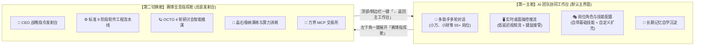
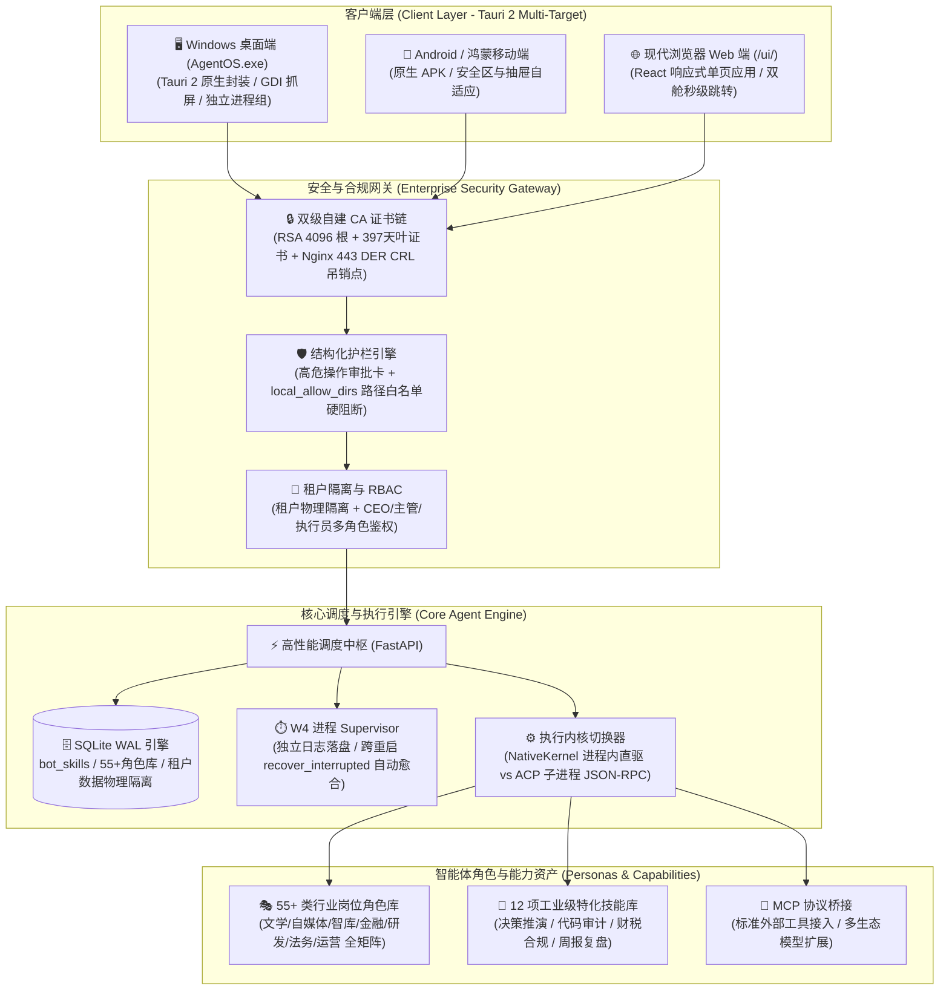

<div align="center">

# 🤖 AgentOS (OA Agent) · 次世代企业级自主智能体协作操作系统

**多端全双工协同 · 55+ 类行业岗位角色 · 动态技能组合 · 桌面原生操控流 · 金融级安全信道 · 自备主机私有化**

<p align="center">
  
  
  
  
  
  
</p>

<p align="center">
  一句话下达业务需求 ➔ 55+ 岗 AI 助手协同 ➔ 实时接管操作电脑 ➔ 智能拆解 WBS 任务 ➔ L0/L1/L2 严苛验收 ➔ 组织经验自动沉淀
</p>

<p align="center">
  <a href="https://github.com/julingwu/agent-OS/raw/mainline/releases/AgentOS.exe">
    
  </a>
  <a href="https://193.112.172.223/ui/AgentOS.exe">
    
  </a>
</p>

---

</div>

## 📑 目录导航

- [✨ 双舱协同架构：主工作台与指挥舱](#-双舱协同架构主工作台与指挥舱)
- [🖼️ 界面全景与真实运行效果](#️-界面全景与真实运行效果)
  - [1. 核心主工作台（登录后主界面）](#1-核心主工作台登录后主界面)
  - [2. 赛博全息指挥舱（工程总装第二舱）](#2-赛博全息指挥舱工程总装第二舱)
  - [3. 55+ 类细分行业角色库 × 10 大专业领域全覆盖](#3-55-类细分行业角色库--10-大专业领域全覆盖)
- [🏛️ 系统架构全景拓扑](#️-系统架构全景拓扑)
- [🚀 六大核心技术支柱](#-六大核心技术支柱)
- [⚖️ 执行内核与 FinOps 预算管控](#️-执行内核与-finops-预算管控)
- [🏁 快速开始与访问指南](#-快速开始与访问指南)
- [🛡️ 质量保证与测试套件](#️-质量保证与测试套件)
- [📂 仓库工程结构](#-仓库工程结构)

---

## ✨ 双舱协同架构：主工作台与指挥舱

传统的 AI 框架要么是“单调的聊天框”，要么是“复杂的后台流水线看板”，割裂了人机对话协作与宏观工程交付。

**AgentOS** 采用独特的**双舱协同架构**，各司其职又无缝秒级跳转：



1. **核心主工作台（登录后默认主界面 · 图 1）**：
   * **业务日常协作核心**：用户登录系统后进入的默认核心界面。
   * **多角色 AI 团队直聊**：左侧展示团队所有助手（如小万、小财、技术架构师、法务顾问），支持一对一专聊、多 Agent 群聊。
   * **右侧实时电脑视窗与控制（Computer-Use）**：原生推流电脑屏幕，随时查看 Agent 正在电脑上干什么，支持一键“取得控制权”直接操作。
   * **角色与技能自由定制**：新建助手时从 55+ 个专业角色预设挑选（覆盖文学网文、自媒体AIGC、量化金融、个人智库等 10 大分类），自动联动职责与基础技能，详情面板可随时扩充或剔除技能。
2. **赛博全息指挥舱（工程总装第二舱 · 图 2）**：
   * **宏观项目总装中枢**：主工作台左下角点击【赛博指挥舱】即可瞬时展开。
   * **复杂软件工程流水线**：9 阶段工程流水线、4 轮研讨会推演、沙盘演练、MCP 工具市场与 FinOps 晶石开销。
   * **双向无缝切回**：指挥舱顶部常驻【← 返回 AI 团队主工作台】按钮，左侧“我的工作空间”随时一键回归对话。

---

## 🖼️ 界面全景与真实运行效果

### 1. 核心主工作台（登录后主界面）
> 55+ 岗 AI 助手团队、多轮上下文会话、右侧原生电脑操控流推流与接管、岗位技能自定义增删。

<div align="center">
  
</div>

### 2. 赛博全息指挥舱（工程总装第二舱）
> CEO 战略指令发射台、9 阶段工程流水线、OCTO 研讨会推演、沙盘演练、万界 MCP 交易所。随时点击顶部 `← 返回对话` 切回主工作台。

<div align="center">
  
</div>

---

### 3. 55+ 类细分行业角色库 × 10 大专业领域全覆盖

系统数据库内建 **55+ 类标准化企业与个人超级角色**（涵盖小说网文、自媒体 AIGC、硬科技量化、独立智库等 10 大矩阵），并出厂预植工业级执行流程技能（新建角色自动绑定专属技能集，且可在会话中随时借调扩展）：

| 行业领域 (10 大分类) | 代表性预设角色 (共 55+ 类) | 专属执行技能与交付物示例 |
|---|---|---|
| **文学与创作** ⭐ | **网文大神 / 小说主笔**、**故事架构师 / 文学责编**、**影视 / 短剧编剧**、**世界观与考据设定师** | **世界观与设定集构建**、**黄金三章与大纲设计**、**密集反转与钩子设计**、**力量体系与考据百科** |
| **自媒体与创作** ⭐ | **自媒体爆款操盘手**、**AIGC视觉与分镜导演** | **全平台爆款标题与封面文案**、**小红书种草图文**、**AI绘画/视频分镜提示词工程**、**角色一致性方案** |
| **金融与硬科技** ⭐ | **MQL5 / 量化交易工程师**、**硬科技产业链首席分析师**、**量化研究员**、**投研分析师** | **MQL5/EA 自动交易策略**、**动态仓位与回撤风控**、**硬科技产业链穿透拆解**、**单品盈利模型与估值对比** |
| **个人智库与商业** ⭐ | **全能私人幕僚长 (Chief of Staff)**、**Prompt与Agent架构师**、**学术文献与深度研究官**、**独立开发者与商业顾问** | **本地文件与桌面自动化整理**、**结构化 System Prompt 设计**、**多 Agent 工作流编排**、**前沿论文拆解**、**MVP商业变现** |
| **技术研发** | 后端架构师、前端工程师、测试开发、DevOps 工程师、数据平台工程师、本地化翻译 | **代码质量与安全审计**、**高并发微服务设计**、**React 组件化**、**CI/CD 自动化流水线** |
| **法务与合规** | 企业合同审查律师、知识产权顾问、数据合规顾问、劳动争议顾问 | **合同审查与风险条款识别**、**出海知识产权布局**、**数据合规评估**、**劳动关系合规指引** |
| **运营与增长** | 用户运营、内容运营、活动运营、私域运营、业务数据分析师 | **用户分层与促活召回**、**社群企微触达 SOP**、**大型促销活动操盘**、**指标异动归因分析** |
| **市场与品牌** | 品牌策划、增长运营、投放优化师、市场调研员 | **品牌定位与心智提炼**、**整合传播节奏**、**信息流投放与出价策略**、**竞品对标与用户访谈** |
| **设计与视觉** | UI视觉设计师、交互设计师、品牌视觉师、动效设计师 | **移动端界面与设计规范**、**可点击流程原型**、**VI 视觉延展**、**微交互转场动效** |
| **通用与管理** | Python极客、严苛的测试员、产品经理 (CPO)、系统架构师、合规审计官、SRE 专家 | **第一性原理决策推演**、**最小可运行原型 (MVP)**、**红线合规一票否决**、**发布回滚监控清单** |

---

## 🏛️ 系统架构全景拓扑



---

## 🚀 六大核心技术支柱

### 1. 核心工作台即主入口，多 Agent 智能协同
* **拒绝千篇一律的通用对话**：系统内置 55+ 个细分行业角色标准定义，登录即直达多 Agent 协作主界面。
* **岗位创建即赋能**：新建助手时挑选角色，系统自动为其初始化核心 Prompt、能力标签与专属基础技能。
* **自由扩展与跨角色赋能**：助手详情面板支持直观增删技能，提供本角色推荐技能库，并支持从其它角色中按需借调。

### 2. 桌面原生执行桥（Desktop Native Bridge）与实时视窗
* **实时桌面推流**：主工作台右侧直接挂载桌面画面，随时观察 Agent 执行操作；
* **Win32 深度硬件交互**：通过 Windows API 实现前台活动窗口枚举与聚焦、多屏坐标计算；
* **超轻量原生抓屏**：利用 Win32 GDI 配合纯 Rust `png` 无损压缩算法抓屏，381ms 极速生成，规避重量级依赖。

### 3. 去中心化自备主机（BYOH - Bring Your Own Host）
* **数据主权私有化**：服务端主机与平台账号物理解耦。企业与个人用户自备 Linux VPS 或本地服务器，数据主权完全私有。
* **一键单行脚本拉起**：在服务器终端执行一行 curl 命令即可完成环境准备与服务守护进程注册。
* **客户端多实例管理**：客户端内置动态服务器切换器与 Ping 延迟探活，一键在“官方节点”、“自备云机”与“局域网实例”间切换。

### 4. 企业级严格护栏与人机共治（Guardrails & HITL）
* **三级权限审批与会话级静默免打扰**：
  * **单次授权 (`once`)**：高危操作（如系统脚本执行、敏感目录文件操作）逐次弹出结构化审批卡由人工批准；
  * **本次会话免打扰 (`session`)**：支持一键开启“本次会话免打扰”，同会话后续同类型安全动作自动静默放行，杜绝高频弹窗干扰；
  * **即时拒绝 (`reject`)**：对不可接受的操作一键拒绝阻断，守护本地安全底线。
* **三层可信验收标准**：
  * **L0 规则自动判定**：语法校验、状态码检查、格式匹配；
  * **L1 人工签批强制留痕**：审批人必须填写 `evidence_snippet` 凭据，**严禁大模型自评通过**；
  * **L2 沙箱脚本真实执行**：在隔离沙箱中跑自动化判据脚本，真实退出码作为唯一通过证据。
* **结构化高危审批卡**：直观展示操作对象人话摘要、目标路径、增减字符量与变更原文预览，消灭“盲批”隐患。
* **目录白名单硬阻断**：服务端全局配置 `local_allow_dirs`，越界路径静默拦截拒绝，不给任何越权穿透机会。

### 5. 全双工跨端协同（Windows Desktop + Web + Android Mobile）
* **Tauri 2 统一架构**：桌面与移动端共享同一套响应式 React 前端，桌面端编译为轻量 Win32 原生可执行文件，移动端直接输出原生 Android APK。
* **移动端抽屉自适应交互**：手机端内置顶部导航、双向侧滑抽屉，全面适配鸿蒙与 Android 主流机型分辨率与 Safe-Area 避让。

### 6. 金融级真证书安全链（Enterprise TLS / CDP / CRL 吊销）
* **拒绝任何不安全的妥协**：客户端彻底移除 `--ignore-certificate-errors` 启动参数。
* **2 级自建私有 CA 体系**：RSA 4096 位根证书（有效期 10 年）+ RSA 2048 位叶证书（有效期 397 天），SAN 覆盖全内网与公网 IP。
* **适配 Windows Schannel 强吊销检查**：叶证书内嵌 CDP（CRL 分发点），配合 Nginx 443 端口发布 DER 格式 CRL 吊销列表，经真实吊销演练验证，完全通过 Schannel 与 curl 的严格握手校验。

---

## ⚖️ 执行内核与 FinOps 预算管控

系统提供双内核架构，支持根据任务重要级别与预算策略动态切换：

| 内核模式 (RUNNER) | 通信机制 | 预算闸门与消耗控制 | 适用场景 |
|---|---|---|---|
| **`mock`**（默认测试） | 进程内直接调度 | 开跑前整笔预扣（消耗 0） | 单元测试、CI 流水线、逻辑自检 |
| **`mock_acp`** | JSON-RPC (Mock 服务端) | 开跑前预扣 + 越线实时取消（消耗 0） | 协议层兼容性测试 |
| **`dsh`** | 子进程 `dsh --profile headless` | 开跑前整笔预扣（黑盒模型，中途无法中断） | 离线批量无交互任务 |
| **`acp`** ⭐ (生产推荐) | `dsh --profile acp` 双向 JSON-RPC | **每次工具调用后推算用量，一旦越线立即触发 `session/cancel` 熔断** | 企业生产实盘任务、预算敏感场景 |

> **FinOps 双口径核算**：任务消耗（`task_runs.usage_tokens`）与阶段 Overhead（立项、研讨、WBS 拆解等管理调度调用）分列计算，并在阶段达 80% 预算线时前置预警熔断，按实时人民币汇率折算账单。

---

## 🏁 快速开始与访问指南

### 1. 服务端一键拉起 (Linux VPS / 自备服务器)

在您的自备服务器上直接执行单行脚本，自动完成环境安装、自签证书、systemd 守护进程与服务启动：

```bash
curl -sSL https://raw.githubusercontent.com/julingwu/agent-OS/mainline/scripts/setup_server.sh | bash
```

### 2. Windows 本地一键启动

```powershell
# 运行一键全栈启动脚本
powershell -ExecutionPolicy Bypass -File scripts\start_all.ps1
```

启动完成后，系统提供两个标准访问入口：

* **【核心主工作台】（登录默认主界面）**：**`http://127.0.0.1:8077/`**（或 `http://127.0.0.1:8077/ui/`）
  * 包含 55+ 岗 AI 助手、多轮协作会话、右侧桌面实时流控制、技能配置。
* **【赛博全息指挥舱】（工程总装第二舱）**：**`http://127.0.0.1:8077/app/`**
  * 包含 9 阶段软件工程流水线、OCTO 研讨沙盘、MCP 交易所，顶部常驻【← 返回主工作台】。

### 3. Windows 原生桌面客户端 (`AgentOS.exe`)

> 💡 **绿色免安装单文件**：仅 6.16 MB，解压或直接双击运行，内置全套 Web 宿主与 Tauri 2 运行时，告别繁琐安装与环境配置。

* 📥 **GitHub 仓库直链下载**：[AgentOS.exe (点击直链下载)](https://github.com/julingwu/agent-OS/raw/mainline/releases/AgentOS.exe)
* 🚀 **云端高速下载镜像**：[https://193.112.172.223/ui/AgentOS.exe](https://193.112.172.223/ui/AgentOS.exe)

**核心特性**：
* 离线内置完整前端包，无需预先启动浏览器；
* 内置主机管理器，支持在官方节点、自备主机、本地开发机之间自由切换并实时探活 Ping 延迟；
* 点击左下角【赛博指挥舱】可随时切入工程视图，点击右上角【← 返回对话】秒级回到工作台。

### 4. Android / 鸿蒙移动端 APK

代码仓库已配置 **GitHub Actions** 自动化移动构建流水线：
* 访问 GitHub 仓库 ➔ **Actions** ➔ **Build Android APK (Tauri 2 Mobile)** ➔ 下载最新的 Artifacts 安装包；
* 手机端自适应主流机型分辨率，提供双向侧滑抽屉与安全区沉浸式体验。

---

## 🛡️ 质量保证与测试套件

我们坚持“测试先于交付”的严谨工程原则。全仓库涵盖 **89 个专业测试文件**，覆盖权限、调度、护栏、事件、进程以及跨平台 API：

```powershell
# 运行全量自动化测试
.\.venv\Scripts\pytest.exe -q
```

**测试执行结果**：
```text
........................................................................ [  8%]
........................................................................ [ 17%]
........................................................................ [ 26%]
........................................................................ [ 35%]
........................................................................ [ 43%]
........................................................................ [ 52%]
........................................................................ [ 61%]
........................................................................ [ 70%]
........................................................................ [ 78%]
........................................................................ [ 87%]
........................................................................ [ 96%]
...............................                                          [100%]
823 passed, 1 warning in 461.40s
```
> **100% 通过（823 passed）**，无一挂起，无一报错。

---

## 📂 仓库工程结构

```text
oaagent-m0/
├── app/                      # 后端核心业务层 (FastAPI + SQLite WAL)
│   ├── agent/                # 循环 Agent 核心与工具调用链
│   ├── api_v1/               # v1 统一对外 API (Bot/会话/设备/流式/角色/技能)
│   ├── computer/             # 桌面操控与交互抽象层
│   ├── local_bridge.py       # 本地硬件与网络网关接入
│   ├── local_policy.py       # 结构化护栏与目录白名单安全策略判定
│   ├── processes.py          # W4 跨平台进程 Supervisor
│   ├── rbac.py               # 租户隔离与角色权限访问控制
│   └── events.py             # 全局流式事件总线 (SSE/WebSocket)
├── releases/                 # 免安装绿色发布包 (AgentOS.exe 桌面客户端)
├── desktop/                  # 核心主工作台前端 (Tauri 2 客户端 + Web 宿主)
│   ├── src/                  # React + Vite 响应式主界面 (图 1: 对话/电脑操控/55+角色/技能)
│   └── src-tauri/            # Tauri 2 原生封装 (Windows exe / Android APK)
├── web/                      # 赛博全息指挥舱前端 (图 2: 总装流水线/研讨沙盘/MCP交易所)
├── ui_dist/                  # 服务端托管的主工作台静态构建包 (对应 /ui/)
├── deploy/                   # 部署与运维配置 (Nginx 反代 / TLS 自签 CA)
├── docs/screenshots/v5/      # 系统最新真机截图 (workspace_main.png / cyberdeck.png)
├── scripts/                  # 一键启动脚本 (start_all.ps1 / setup_server.sh)
├── tests/                    # 89 个全面回归测试套件 (823 条用例)
└── .github/workflows/        # GitHub Actions 自动化打包流水线 (Android APK)
```

---

<div align="center">
  <sub>AgentOS · 次世代企业级自主智能体协作操作系统 · 双舱协同 · 保障数据主权与物理安全底线</sub>
</div>
