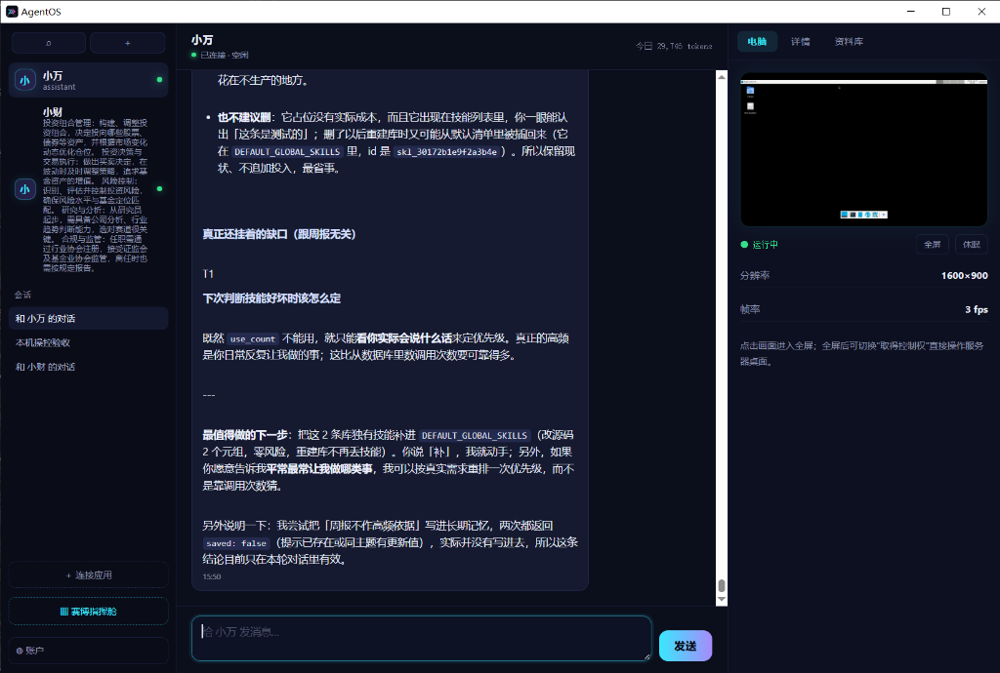
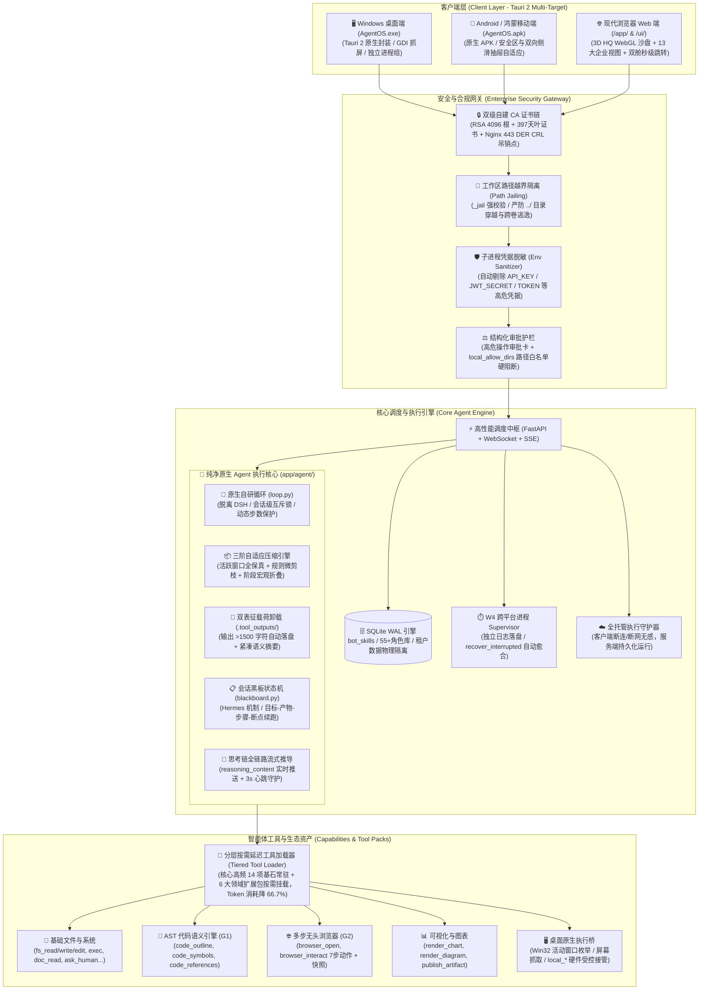

<div align="center">

# 🤖 AgentOS (OA Agent) · 次世代企业级自主智能体协作操作系统

**多端全双工协同 · 55+ 类行业岗位角色 · 纯净原生 Agent 内核 · 三阶自适应压缩 · Hermes 会话黑板 · 金融级安全信道 · 自备主机私有化**

<p align="center">
  
  
  
  
  
  
  
</p>

<p align="center">
  一句话下达业务需求 ➔ 55+ 岗 AI 助手协同 ➔ 原生多工具链式自决 ➔ 3D 智能总部全景沙盘 ➔ L0/L1/L2 严苛验收 ➔ 组织经验自动沉淀
</p>

<p align="center">
  <a href="https://github.com/julingwu/agent-OS/releases/download/v5.5.0/AgentOS.exe">
    
  </a>
  <a href="https://193.112.172.223/ui/AgentOS.exe">
    
  </a>
  <a href="https://github.com/julingwu/agent-OS/releases/download/v5.5.0/AgentOS.apk">
    
  </a>
  <a href="https://193.112.172.223/ui/AgentOS.apk">
    
  </a>
</p>

---

</div>

## 📑 目录导航

- [✨ 双舱协同架构：主工作台与赛博指挥舱](#-双舱协同架构主工作台与赛博指挥舱)
- [🖼️ 界面全景与真实运行效果](#️-界面全景与真实运行效果)
  - [1. 核心主工作台（登录后默认主界面）](#1-核心主工作台登录后默认主界面)
  - [2. 赛博指挥舱（3D HQ 智能总部沙盘 + 13 大企业级管理视图）](#2-赛博指挥舱3d-hq-智能总部沙盘--13-大企业级管理视图)
  - [3. 55+ 类细分行业角色库 × 10 大专业领域全覆盖](#3-55-类细分行业角色库--10-大专业领域全覆盖)
- [🏛️ 系统架构全景拓扑](#️-系统架构全景拓扑)
- [🧠 对齐顶级 Agent 的九大核心技术支柱](#-对齐顶级-agent-的九大核心技术支柱)
  - [1. 纯净原生 Agent 核心（脱离 DSH 依赖，自研高可靠执行循环）](#1-纯净原生-agent-核心脱离-dsh-依赖自研高可靠执行循环)
  - [2. 三阶自适应上下文压缩与双表征卸载引擎（Codex + Claude Code 理念）](#2-三阶自适应上下文压缩与双表征卸载引擎codex--claude-code-理念)
  - [3. Session Blackboard 会话黑板状态机（Hermes 机制）](#3-session-blackboard-会话黑板状态机hermes-机制)
  - [4. AST 代码语义与符号分析引擎（G1 原生 AST 智能）](#4-ast-代码语义与符号分析引擎g1-原生-ast-智能)
  - [5. 多步无头浏览器与视觉快照联动（G2 网页自动化与视觉留存）](#5-多步无头浏览器与视觉快照联动g2-网页自动化与视觉留存)
  - [6. 安全沙箱环境隔离与凭据脱敏（G3 路径越界隔离 + 环境变量脱敏）](#6-安全沙箱环境隔离与凭据脱敏g3-路径越界隔离--环境变量脱敏)
  - [7. 分层按需延迟工具加载（G4 动态 Tool Schema 懒加载，消耗骤降 66.7%）](#7-分层按需延迟工具加载g4-动态-tool-schema-懒加载消耗骤降-667)
  - [8. 深度思考（Reasoning / Thought）全链路流式推导（DeepSeek-R1 / Flash 推理）](#8-深度思考reasoning--thought全链路流式推导deepseek-r1--flash-推理)
  - [9. 工业级鲁棒性与防死循环保护（大载荷截断、参数容错、智能步数保护）](#9-工业级鲁棒性与防死循环保护大载荷截断参数容错智能步数保护)
- [🧰 Agent 原生工具生态全景矩阵（54 项自研原生工具一览）](#-agent-原生工具生态全景矩阵54-项自研原生工具一览)
- [⚖️ 执行内核与 FinOps 预算管控](#️-执行内核与-finops-预算管控)
- [🏁 快速开始与客户端下载](#-快速开始与客户端下载)
- [🛡️ 质量保证与测试套件](#️-质量保证与测试套件)
- [📂 仓库工程结构](#-仓库工程结构)
- [🙏 开源致谢与说明](#-开源致谢与说明)

---

## ✨ 双舱协同架构：主工作台与赛博指挥舱

传统的 AI 框架要么是“单调的聊天框”，要么是“复杂的后台流水线看板”，割裂了人机对话协作与宏观工程交付。

**AgentOS** 采用独特的**双舱协同架构**，各司其职又无缝秒级跳转：

```mermaid
flowchart LR
    subgraph CoreWorkspace ["【第一主舱】AI 团队协同工作台 (默认主界面)"]
        Chat["💬 多助手多轮协作会话<br/>(小万、小财等 55+ 行业岗位)"]
        Stream["🖥️ 实时桌面推流与键鼠接管<br/>(低延迟推流 + Win32 原生交互)"]
        CloudHost["☁️ 云端全托管持久执行<br/>(客户端关闭/手机锁屏断网服务端照常跑)"]
        Scroll["⚓ 深色极简滚动条与一键触底<br/>(↓ 悬浮锚点 + thought.delta 思考流实时滚动)"]
        RolesConfig["🎭 岗位角色与技能自由定制<br/>(自带基础技能 + 动态扩展)"]
    end

    subgraph CyberDeck ["【第二切换舱】赛博指挥舱 (3D HQ 智能总部 + 13 大视图)"]
        HQ["🏢 3D HQ 智能总部沙盘<br/>(回字形单层 / 5档昼夜光影 / 实时阴影)"]
        NekoChief["🐱 总指挥「小枢」统筹调度<br/>(8大职能部门 / 31名Q版寻路 / 周会评审)"]
        LiveLink["⚡ 真实业务直连<br/>(云端立项 / /ws/metacorp / 80%预算熔断)"]
        MCPEx["🔌 万界 MCP 交易所<br/>(工具资产交易 / 蓝图装配)"]
        Views2D["📊 13 大企业级管理视图<br/>(工作台/总装流水线/任务/会话/产物/审批/用量...)"]
    end

    CoreWorkspace -- "左侧导航 / 顶栏一键切换「赛博指挥舱」" --> CyberDeck
    CyberDeck -- "顶部常驻「← 返回 AI 团队主界面」" --> CoreWorkspace
```



1. **第一主舱（AI 团队协同工作台 · 业务日常协作核心）**：
   * **登录后核心主界面**：用户登录系统后进入的默认高效操作空间。
   * **55+ 岗 AI 助手团队**：左侧展示团队所有助手（涵盖小说主笔、量化研究员、系统架构师、法务顾问等），支持一对一深度对话与多 Agent 群聊接力协同。
   * **右侧实时电脑视窗与控制（Computer-Use）**：原生推流电脑屏幕，随时查看 Agent 正在电脑上执行的操作，支持一键“取得控制权”直接操作。
   * **云端全托管持久执行**：核心任务全生命周期托管于云端服务，**客户端关闭或移动端断网后，服务端原生执行循环照常运行到底**，重新打开客户端无缝同步最新状态。
   * **深度思考全链路推导展示**：全面原生接入 DeepSeek-R1 / Gemini Flash 等推理模型的 `reasoning_content`，思考过程实时流式呈现，辅以一键触底锚点与极简滚动条。
   * **角色与技能自由定制**：新建助手时挑选 55+ 专业角色预设，自动初始化核心技能，支持在面板中灵活增减与借调跨角色技能包。

2. **第二切换舱（赛博指挥舱 · 3D HQ 智能总部 + 13 大企业级管理视图）**：
   * **原生 WebGL 3D HQ 智能总部沙盘**：基于轻量原生 WebGL 渲染管线打造的「回字形」单层 3D 企业智能总部沙盘，具备实时阴影、5 档昼夜光影切换、移轴景深与泛光特效；正中总指挥 **「小枢」** 统筹 **产品部、设计部、市场部、运营部、研发部、人事部、财务部、法务行政部** 8 大职能部门，31 名 Q 版角色在走廊依照最短路径动态寻路、跨部门递送文件夹、参与周会评审与茶水间小憩。
   * **实盘业务数据无缝联动**：与 AgentOS 云端后端深度打通，支持一键立项并派发任务、实时监听 `/ws/metacorp` 事件总线、统计各部门实时 Token 消耗账本与 80% 阶段预算熔断预警，内置 **万界 MCP 交易所** 支持一键安装扩展工具蓝图。
   * **完整 13 大专业 2D 管理视图**：左侧完整保留 **工作台、总装流水线、任务中心、协作会话、工作产物、审批中心、组织与团队、角色库、用量与费用、评测中心、组织经验、工具与集成、系统维护** 13 大企业级管理视图，支持随时展开任务审查与审批流。
   * **双向无缝切回**：指挥舱顶部常驻【← 返回 AI 团队主界面】按钮，随时一键回归对话工作台。

---

## 🖼️ 界面全景与真实运行效果

### 1. 核心主工作台（登录后默认主界面）
> 55+ 岗 AI 助手团队、多轮上下文会话、原生 Agent 执行循环、右侧桌面实时流控制、岗位技能自定义增删、云端持久执行与一键触底锚点。

<div align="center">
  
</div>

### 2. 赛博指挥舱（3D HQ 智能总部沙盘 + 13 大企业级管理视图）
> 原生 WebGL「回字形」3D 智能总部沙盘、总指挥「小枢」调度 8 大部门与 31 名员工、动态光影与事件流、实盘任务创建、MCP 交易所与 13 大企业级管理视图。随时点击顶部 `← 返回 AI 团队主界面` 秒级切回。

<div align="center">
  
</div>

---

### 3. 55+ 类细分行业角色库 × 10 大专业领域全覆盖

系统数据库内建 **55+ 类标准化企业与个人超级角色**（涵盖小说网文、自媒体 AIGC、硬科技量化、独立智库等 10 大矩阵），并出厂预植工业级执行流程技能（新建角色自动绑定专属技能集，且可在会话中随时借调扩展）：

| 行业领域 (10 大分类) | 代表性预设角色 (共 55+ 类) | 专属执行技能与交付物示例 |
|---|---|---|
| **文学与创作** ⭐ | **网文大神 / 小说主笔**、**故事架构师 / 文学责编**、**影视 / 短剧编剧**、**世界观与考据设定师** | **世界观与设定集构建**、**黄金三章与大纲设计**、**密集反转与钩子设计**、**力量体系与考据百科** |
| **自媒体与创作** ⭐ | **自媒体爆款操盘手**、**AIGC视觉与分镜导演** | **全平台爆款标题与封面文案**、**小红书种草图文**、**AI绘画/视频分镜提示词工程**、**角色一致性方案** |
| **金融与硬科技** ⭐ | **黄金与大宗商品首席分析师**、**MQL5 / 量化交易工程师**、**硬科技产业链分析师**、**量化研究员**、**投研分析师** | **宏观黄金定价模型**、**MQL5/EA 自动交易策略**、**动态仓位与回撤风控**、**硬科技产业链穿透拆解**、**单品盈利模型与估值对比** |
| **个人智库与商业** ⭐ | **全能私人幕僚长 (Chief of Staff)**、**Prompt与Agent架构师**、**学术文献与深度研究官**、**独立开发者与商业顾问** | **本地文件与桌面自动化整理**、**结构化 System Prompt 设计**、**多 Agent 工作流编排**、**前沿论文拆解**、**MVP商业变现** |
| **技术研发** | 后端架构师、前端工程师、测试开发、DevOps 工程师、数据平台工程师、本地化翻译 | **代码语义大纲与符号交叉索引**、**代码质量与安全审计**、**高并发微服务设计**、**CI/CD 自动化流水线** |
| **法务与合规** | 企业合同审查律师、知识产权顾问、数据合规顾问、劳动争议顾问 | **合同审查与风险条款识别**、**出海知识产权布局**、**数据合规评估**、**劳动关系合规指引** |
| **运营与增长** | 用户运营、内容运营、活动运营、私域运营、业务数据分析师 | **用户分层与促活召回**、**社群企微触达 SOP**、**大型促销活动操盘**、**指标异动归因分析** |
| **市场与品牌** | 品牌策划、增长运营、投放优化师、市场调研员 | **品牌定位与心智提炼**、**整合传播节奏**、**信息流投放与出价策略**、**竞品对标与用户访谈** |
| **设计与视觉** | UI视觉设计师、交互设计师、品牌视觉师、动效设计师 | **移动端界面与设计规范**、**可点击流程原型**、**VI 视觉延展**、**微交互转场动效** |
| **通用与管理** | Python极客、严苛的测试员、产品经理 (CPO)、系统架构师、合规审计官、SRE 专家 | **第一性原理决策推演**、**最小可运行原型 (MVP)**、**红线合规一票否决**、**发布回滚监控清单** |

---

## 🏛️ 系统架构全景拓扑



---

## 🧠 对齐顶级 Agent 的九大核心技术支柱

经过深度重构与架构升级，AgentOS 全面看齐当前国际顶级自主智能体（**Codex / Claude Code / Nous Hermes**）的工业交付标准，构建了九大硬核技术支柱：

### 1. 纯净原生 Agent 核心（脱离 DSH 依赖，自研高可靠执行循环）
- **告别笨重黑盒**：彻底移除对外部黑盒二进制（原 DSH CLI 模式）的运行依赖，实现 100% 全自研的轻量高可靠执行循环（[`app/agent/loop.py`](file:///c:/oaagent-m0/app/agent/loop.py)）；
- **全生命周期事件化**：严格映射标准事件总线（`turn.started` → 智能工具递归链式决策 → `tool.call` / `tool.result` → `thought.delta` / `message.delta` 流式推导 → `turn.ended` → `budget.updated`）；
- **进程内互斥隔离**：采用 `_session_lock` 会话级互斥锁，保障单一会话内状态线性的同时支持全局多租户高并发安全执行。

### 2. 三阶自适应上下文压缩与双表征卸载引擎（Codex + Claude Code 理念）
为解决复杂长任务中的“模型失忆”、“上下文溢出”与“大输出挤爆 Token”问题，打造了先进的动态压缩管线：
- **大输出双表征卸载（Dual-Representation Offloading）**：
  - 当工具输出内容超过 **1,500 字符**时，系统自动将完整原始数据（日志、长网页、编译结果）持久化写入工作区 [`.tool_outputs/step_{call_id}_{tool}.log`](file:///c:/oaagent-m0/app/agent/tools.py#L264-L343)；
  - 上下文注入结构化紧凑视图（包含 `ok`, `summary`, `output_file`, `total_chars`, `_hint`），支持后续通过 `fs_read`（行号切片）或 `grep_search` 按需精准检索，模型上下文占用下降 **80%+**；
- **三阶自适应上下文压缩（Adaptive Context Compaction）**：
  - **活跃保护区（Active Window）**：对最近 4 步工具往返（约 8~10 条消息）实行 **100% 原始绝对保真**，绝不裁剪；
  - **Phase 1 规则微剪枝（Rule-based Micro-Pruning）**：对 4 步前的历史输出进行零 LLM 消耗的轻量紧缩，提取核心状态、错误码与前 200 字符结论；
  - **Phase 2 宏观阶段折叠（Macro-Compaction）**：若全局 Token 仍超出目标预算，将早期连续探索步骤折叠为阶段成果摘要，并严格维持 `assistant` 与 `tool` 语法对齐；
- **1M 超长上下文高效流转**：彻底告别长任务中途丢上下文、步骤中断的顽疾。

### 3. Session Blackboard 会话黑板状态机（Hermes 机制）
- **断点记忆中枢**：引入会话级黑板状态机（[`app/agent/blackboard.py`](file:///c:/oaagent-m0/app/agent/blackboard.py)），提供 SQLite 数据表与工作区 `.blackboard/{session_id}.json` 双重持久化；
- **四大核心资产结构化沉淀**：
  1. `last_goal`：当前会话的核心任务总体目标；
  2. `artifacts`：已产出的交付物清单（研报、代码、图表、配置文件）；
  3. `completed_steps`：已完成的工具执行步骤与关键结论摘要；
  4. `next_step_hint`：下一阶段行动建议与断点提示；
- **无缝断点续跑**：用户发送“继续”、“接着做”、“下一步”、“continue”等指令时，引擎自动匹配意图并挂载黑板状态摘要，**无需大模型重新扫描数万字历史会话**，瞬间恢复断点继续执行。

### 4. AST 代码语义与符号分析引擎（G1 原生 AST 智能）
内置轻量高效的代码语义与符号分析引擎（[`app/agent/code_tools.py`](file:///c:/oaagent-m0/app/agent/code_tools.py)），赋能 Agent 拥有专业 IDE 级别的代码感知力：
- **`code_outline`**：基于 Python 原生 AST 及高性能正则解析器（全面支持 Python, JS/TS, Go, Java, Rust, C/C++），毫秒级提取代码文件大纲、类与函数的起止行号、装饰器、类型签名与文档注释；
- **`code_symbols`**：工作区全量代码符号递归扫描与轻量倒排索引，结合 `.code_index.json` 增量缓存与模糊搜索，快速定位符号定义位置；
- **`code_references`**：跨文件符号交叉引用追踪，毫秒级定位函数调用点、类继承与导入关系；
- **告别盲目全文件读写**：配合 `fs_read` 精确行号切片与 `fs_edit` 外科手术式局部替换，代码阅读与修改 Token 消耗降低 70% 以上。

### 5. 多步无头浏览器与视觉快照联动（G2 网页自动化与视觉留存）
深度整合现代 Web 自动化交互套件（[`app/agent/browser_tools.py`](file:///c:/oaagent-m0/app/agent/browser_tools.py) 与 `web_tools.py`）：
- **7 大交互动作编排**：支持在单次工具调用中串联 `navigate`（页面导航）、`click`（CSS 选择器精准点击）、`type`（表单填报与输入）、`scroll`（动态滚动与懒加载触发）、`wait`（显式等待元素呈现）、`extract`（DOM 结构与文本提取）、`screenshot`（全页面/元素级高保真视觉截图）；
- **优雅无缝降级**：当宿主环境未安装 Chromium 浏览器二进制时，自动降级为静态 DOM 抓取与 PIL 结构化卡片渲染，保证任务不中断；
- **视觉图文交付**：截取的网页快照自动沉淀为工作产物（Artifacts），并在对话流与研报中以高分辨率图片直接嵌入展示。

### 6. 安全沙箱环境隔离与凭据脱敏（G3 路径越界隔离 + 环境变量脱敏）
针对企业生产环境的安全合规要求，构筑多道硬核防线：
- **工作区路径越界隔离（Path Jailing）**：系统在底层 `_jail()` 函数中实施严格校验，所有文件系统与代码工具强限制在 `M0_WORKSPACE` 目录内，严防 `../` 目录穿越、软链接跳跃或绝对路径逃逸；
- **子进程敏感凭据脱敏（Env Redaction）**：所有子进程及 `exec` 命令执行前，自动调用 `sanitize_env()` 强力剔除环境变量中的 `DEEPSEEK_API_KEY`、`OPENAI_API_KEY`、`JWT_SECRET`、`DATABASE_URL` 及 `*_SECRET` / `*_TOKEN` 等敏感字段，从物理机制上杜绝凭据泄漏；
- **高危操作三级审批**：删除关键数据、向外部转账等高危动作强制挂起并触发结构化审批卡，由人工确认通过后方可执行。

### 7. 分层按需延迟工具加载（G4 动态 Tool Schema 懒加载，消耗骤降 66.7%）
对标顶级编码 Agent 的分级架构设计（[`get_effective_tool_specs`](file:///c:/oaagent-m0/app/agent/tools.py#L1340-L1398)）：
- **14 项基础核心工具（Core Tools）常驻**：涵盖 `fs_read/write/edit`、`exec`、`web_search`、`doc_read`、`code_outline` 等，确保基础任务即时响应；
- **6 大领域专属扩展包按需挂载**：
  - `VISUAL`（图表与架构渲染包）：匹配数据分析、架构师角色或画图意图时挂载；
  - `BROWSER`（无头浏览器交互包）：匹配网页、爬虫、登录、点击意图时挂载；
  - `PROCESS`（后台守护进程包）：匹配服务启动、日志监控意图时挂载；
  - `CODE`（深度代码索引与交叉引用包）：匹配代码审查、符号追踪意图时挂载；
  - `LOCAL_DESKTOP`（本地桌面原生接管包）：仅在用户明确指令在本机操作时受控挂载；
  - `ADVANCED_CODEX`（子代理分派与 MCP 协议包）：匹配多任务分拆或协议调用时挂载；
- **提示词 Token 消耗大幅下降**：默认场景下 Tool Schema 提示词 Token 消耗降低 **66.7%**，有效消除工具调用“幻觉”与请求延迟。

### 8. 深度思考（Reasoning / Thought）全链路流式推导（DeepSeek-R1 / Flash 推理）
- **原生全双工思考流**：完美解析主流大模型（DeepSeek-R1、Gemini Flash Thinking）的 `reasoning_content`，将推导逻辑以毫秒级 `thought.delta` 事件实时推送前端；
- **思考守护心跳（Keepalive Heartbeat）**：模型在深度思考或耗时计算时，后台每 3 秒自动发送思考心跳与进度更新，彻底消灭前端“卡屏、无滚动字”的静默焦虑；
- **多步工具调用上下文自愈**：在多步循环中严格对齐并回填 `reasoning_content`，完美遵循推理模型对历史轮次的严格校验；
- **思考结论智能抽取**：偶发模型仅输出思考链而正文空白时，系统自动从思维链末端智能提炼结论，保障用户体验连贯。

### 9. 工业级鲁棒性与防死循环保护（大载荷截断、参数容错、智能步数保护）
- **32KB 超大载荷事件安全截断**：工具参数大于 1200 字符、工具返回大于 2000 字符时自动生成事件级精简预览（`_sanitize_tool_args_for_event` / `_sanitize_tool_result_for_event`），防止超大报文塞爆 SQLite WAL 与前端 WebSocket 信道；
- **参数别名容错与类型自适应**：自动兼容 `path`、`file`、`filename`、`filepath` 等常见别名变体；参数类型支持安全数字（`_safe_int`）与布尔（`_safe_bool`）自适应解析；
- **智能单轮步数保护**：可配置 `AGENT_MAX_STEPS`（默认 30 步），步数用尽时触发模型强制生成条目化进度总结，并引导用户回复「**继续**」无缝接力，杜绝无意义工具死循环与虚假上限告警。

---

## 🧰 Agent 原生工具生态全景矩阵（54 项自研原生工具一览）

系统内建 **54 项全自研原生工具**，划分为 1 个核心常驻工具集与 6 大领域扩展工具包：

| 工具类别 | 挂载策略 | 核心工具清单 | 功能职责与技术亮点 |
|---|---|---|---|
| **核心工作区与文件** | **Core 常驻** | `fs_read`, `fs_write`, `fs_edit`, `fs_list`, `glob_search`, `grep_search`, `doc_read` | 工作区沙箱受限读写、精确行号切片、外科手术式无损替换、Office/PDF/Excel 多格式深层解析 |
| **执行与进程守护** | **Core / PROCESS** | `exec`, `process_start`, `process_list`, `process_logs`, `process_stop` | 子进程隔离执行、环境变量安全脱敏、后台守护进程生命周期管理、超时熔断与超长输出落盘 |
| **AST 代码语义智能** | **Core / CODE** | `code_outline`, `code_symbols`, `code_references` | 原生 AST 语法大纲提取、工作区符号倒排索引与增量缓存、全仓库调用链交叉引用分析 |
| **网络与浏览器交互** | **Core / BROWSER** | `web_search`, `web_fetch`, `browser_open`, `browser_interact` | 实时联网检索事实、网页清洗转 Markdown、7 步网页自动化交互（点击/表单/滚动/快照） |
| **图表与可视化交付** | **VISUAL 动态挂载** | `render_chart`, `render_diagram`, `publish_artifact` | 生成高分辨率数据图表（折线/柱状/雷达/估值走势）与架构时序图，交付物自动发布为 Artifact |
| **规划记忆与子代理** | **Core / ADVANCED** | `todo_write`, `todo_read`, `delegate_task`, `remember`, `recall`, `ask_human` | Hermes 风格多步任务清单跟踪、4 线程 Subagent 并行分派、长期向量记忆、高危操作人工审批 |
| **技能沉淀与例程** | **Core / ADVANCED** | `list_skills`, `use_skill`, `skill_save`, `skill_delete`, `routine_create`, `routine_delete`, `list_routines` | 团队成功经验固化为 Skill 资产、定时周期例行任务调度与执行 |
| **协议与计算机控制** | **ADVANCED_CODEX** | `computer_screenshot`, `computer_action`, `computer_info`, `mcp_list_tools`, `mcp_call` | Codex 风格 Computer-Use 原生动作执行、万界 MCP 协议工具发现与调用 |
| **桌面本地硬件网关** | **LOCAL_DESKTOP** (受控) | `local_info`, `local_list`, `local_read`, `local_write`, `local_exec`, `local_apps`, `local_open`, `local_windows`, `local_focus`, `local_type`, `local_keys`, `local_click`, `local_close`, `local_screenshot` | 严格需用户明确授权方可触发，Win32 原生活动窗口枚举与聚焦、硬件键鼠控制、原生推流截屏 |

---

## ⚖️ 执行内核与 FinOps 预算管控

系统执行架构已全面转向**纯净原生自主循环（Native Kernel）**：

| 内核模式 (RUNNER) | 运行机制 | 预算闸门与消耗控制 | 适用场景 |
|---|---|---|---|
| **`native`** ⭐ (核心主推) | **进程内异步全自研执行循环 (`app/agent/loop.py`)** | **单步实时 Token 账本推算，超限即时熔断，会话黑板无缝续跑** | **企业生产实盘任务、多工具多轮对话、深度思考交互** |
| **`mock`** | 进程内直接调度 | 开跑前整笔预扣（消耗 0） | 单元测试、CI 流水线、逻辑自检 |
| **`mock_acp`** | JSON-RPC (Mock 服务端) | 开跑前预扣 + 越线实时取消（消耗 0） | 协议层兼容性测试 |
| **`acp`** (兼容模式) | 子进程双向 JSON-RPC | 每次工具调用后推算用量，越线触发 `session/cancel` 熔断 | 遗留旧版环境兼容 |

> **FinOps 双口径核算**：任务消耗（`task_runs.usage_tokens`）与阶段 Overhead（立项、研讨、WBS 拆解等管理调度调用）分列计算，并在阶段达到 **80% 预算线**时前置预警熔断，按实时人民币汇率折算账单。

---

## 🏁 快速开始与客户端下载

### 1. 服务端一键拉起 (Linux VPS / 自备服务器)

在您的自备服务器上直接执行单行脚本，自动完成环境安装、自签证书、systemd 守护进程与服务启动：

```bash
curl -sSL https://raw.githubusercontent.com/julingwu/agent-OS/mainline/scripts/setup_server.sh | bash
```

### 2. Windows 本地一键启动

```powershell
# 运行一键全栈启动脚本
powershell -ExecutionPolicy Bypass -File scripts\start_all.ps1
```

启动完成后，系统提供两个标准 Web 访问入口：

* **【核心主工作台】（登录默认主界面）**：**`http://127.0.0.1:8077/`**（或 `http://127.0.0.1:8077/ui/`）
  * 包含 55+ 岗 AI 助手、多轮协作会话、原生 Agent 执行循环、右侧桌面实时流控制、技能配置。
* **【赛博指挥舱】（工程总装第二舱）**：**`http://127.0.0.1:8077/app/`**
  * 包含 3D HQ 智能总部沙盘、总指挥「小枢」、8 大职能部门、MCP 交易所与 13 大企业管理视图，顶部常驻【← 返回主工作台】。

### 3. Windows 原生桌面客户端 (`AgentOS.exe`)

> 💡 **绿色免安装单文件**：仅 6.16 MB，解压或直接双击运行，内置全套 Web 宿主与 Tauri 2 运行时，告别繁琐安装与环境配置。

* 📥 **GitHub Releases 官方下载**：[AgentOS.exe (v5.5.0 点击下载)](https://github.com/julingwu/agent-OS/releases/download/v5.5.0/AgentOS.exe)
* 📥 **GitHub 仓库直链备用**：[AgentOS.exe (raw 链接)](https://github.com/julingwu/agent-OS/raw/mainline/releases/AgentOS.exe)
* 🚀 **云端极速下载镜像**：[https://193.112.172.223/ui/AgentOS.exe](https://193.112.172.223/ui/AgentOS.exe)

### 4. Android / 鸿蒙移动端客户端 (`AgentOS.apk`)

> 📱 **移动协同随时随地**：针对触控屏优化双向抽屉交互，完整支持实时会话、审批流签批与云端任务巡检。

* 📥 **GitHub Releases 官方下载**：[AgentOS.apk (v5.5.0 点击下载 · 118MB)](https://github.com/julingwu/agent-OS/releases/download/v5.5.0/AgentOS.apk)
* 🚀 **云端极速下载镜像**：[https://193.112.172.223/ui/AgentOS.apk](https://193.112.172.223/ui/AgentOS.apk)

---

## 🛡️ 质量保证与测试套件

我们坚持“测试先于交付”的严谨工程原则。全仓库涵盖 **104 个专业测试套件**，总计 **957 条自动化测试用例**，覆盖权限、调度、护栏、事件、进程、AST 符号分析、上下文压缩、黑板状态机以及跨平台 API：

```powershell
# 运行核心 Agent 架构测试套件
.\.venv\Scripts\pytest.exe tests/test_adaptive_context_compaction.py tests/test_thought_streaming_and_step_guard.py tests/test_code_tools.py tests/test_browser_interact.py tests/test_sandboxing_and_tiered_tools.py tests/test_agent_robustness.py tests/test_agent_full_toolkit.py tests/test_agent_v1.py -q
```

**核心 Agent 执行结果**：
```text
........................................................................ [ 84%]
.............                                                            [100%]
85 passed, 1 warning in 86.87s
```
> **核心 Agent 架构测试 100% 通过（85 passed）**，无一挂起，无一报错。

---

## 📂 仓库工程结构

```text
oaagent-m0/
├── app/                      # 后端核心业务层 (FastAPI + SQLite WAL)
│   ├── agent/                # 纯净原生 Agent 核心与工具链
│   │   ├── loop.py           # 原生执行循环、三阶上下文压缩、思考流式推导
│   │   ├── blackboard.py     # Hermes 会话黑板状态机与断点续跑
│   │   ├── tools.py          # 54 项工具注册中心、分层懒加载与沙箱落盘
│   │   ├── code_tools.py     # AST 代码语义大纲与符号交叉引用引擎 (G1)
│   │   ├── browser_tools.py  # 7 步无头浏览器自动化交互与快照引擎 (G2)
│   │   ├── web_tools.py      # 实时全网检索与网页转 Markdown
│   │   ├── doc_tools.py      # PDF / Word / Excel / PPTX / CSV 文档深度解析
│   │   └── ext_tools.py      # 进程守护、架构绘图与扩展工具
│   ├── api_v1/               # v1 统一对外 API (Bot/会话/设备/流式/角色/技能)
│   ├── computer/             # 桌面操控与交互抽象层
│   ├── local_bridge.py       # 本地硬件与网络网关接入
│   ├── local_policy.py       # 结构化护栏与目录白名单安全策略判定
│   ├── processes.py          # W4 跨平台进程 Supervisor
│   ├── rbac.py               # 租户隔离与角色权限访问控制
│   └── events.py             # 全局流式事件总线 (SSE/WebSocket)
├── releases/                 # 免安装绿色发布包 (AgentOS.exe 桌面客户端)
├── desktop/                  # 核心主工作台前端 (Tauri 2 客户端 + Web 宿主)
│   ├── src/                  # React + Vite 响应式主界面 (图 1: 对话/电脑操控/55+角色/技能)
│   └── src-tauri/            # Tauri 2 原生封装 (Windows exe / Android APK)
├── web/                      # 赛博指挥舱前端 (图 2: 3D HQ 智能总部沙盘 + 13 大企业视图)
│   ├── src/
│   │   ├── CyberHQEngine.jsx # 3D HQ WebGL 沙盘 React 容器封装
│   │   ├── hq_engine_core.js # 3D HQ 智能总部原生 WebGL 核心渲染引擎
│   │   └── CyberFactorioDeck.jsx # 赛博指挥舱主控板与万界 MCP 交易所
├── ui_dist/                  # 服务端托管的主工作台静态构建包 (对应 /ui/)
├── deploy/                   # 部署与运维配置 (Nginx 反代 / TLS 自签 CA)
├── docs/screenshots/v5/      # 系统最新真机截图 (workspace_main.png / cyberdeck.png)
├── scripts/                  # 一键启动脚本 (start_all.ps1 / setup_server.sh)
├── tests/                    # 104 个全面回归测试套件 (957 条用例)
└── .github/workflows/        # GitHub Actions 自动化打包流水线 (Android APK)
```

---

## 🙏 开源致谢与说明

- **「10 · HQ 智能总部」3D 引擎沙盘**：基于 [@赛博老爸](https://github.com/cyberdaddyleo) 的开源项目 [`cyberdaddyleo/agent-display`](https://github.com/cyberdaddyleo/agent-display) v10.0 HQ 智能总部深度集成改造，遵循 [PolyForm Noncommercial License 1.0.0](https://polyformproject.org/licenses/noncommercial/1.0.0/) 许可规范。在此向作者的卓越视觉工程与沙盘构想致以诚挚感谢！
- **Tauri 2**：提供极速轻量的跨端原生打包支持。
- **FastAPI**：提供高性能异步调度 API 与 WebSocket 实时流。

---

<div align="center">
  <sub>AgentOS · 次世代企业级自主智能体协作操作系统 · 纯净原生 Agent 内核 · 双舱协同 · 保障数据主权与物理安全底线</sub>
</div>
