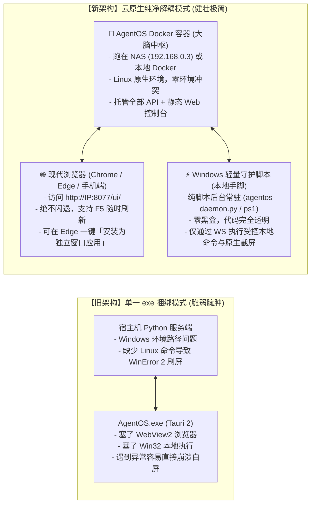

# AgentOS 云原生架构改造：Docker 容器化 + 浏览器控制台 + 本地轻量守护器

> 本方案彻底剥离原先笨重且容易闪退的 `AgentOS.exe` 桌面客户端，回归正统的企业级生产力架构：  
> **重型服务进 Docker，高频交互归标准浏览器，本地手脚归轻量透明守护脚本。**

---

## 一、 新旧架构对比



---

## 二、 交付的核心文件清单

| 文件路径 | 作用说明 | 使用方法 |
| :--- | :--- | :--- |
| [`Dockerfile`](file:///d:/Agent-OS/Dockerfile) | 服务端容器化构建定义 | `docker build -t agentos-server .` |
| [`docker-compose.yml`](file:///d:/Agent-OS/docker-compose.yml) | 容器编排定义（端口映射 + 数据卷持久化） | `docker compose up -d` |
| [`agentos-daemon.py`](file:///d:/Agent-OS/agentos-daemon.py) | Windows 本地轻量级守护进程 | 后台常驻，连接 `WS /v1/device` |
| [`start-daemon.cmd`](file:///d:/Agent-OS/start-daemon.cmd) | 一键静默启动本地守护进程 | 双击运行（桌面有对应快捷方式） |
| [`stop-daemon.cmd`](file:///d:/Agent-OS/stop-daemon.cmd) | 一键停止本地守护进程 | 双击运行 |
| [`open-web.cmd`](file:///d:/Agent-OS/open-web.cmd) | 一键在浏览器打开 AgentOS Web 控制台 | 双击即可在默认浏览器打开 |
| `C:\Users\anxin\Desktop\AgentOS Web 工作台.url` | 桌面直达 Web 工作台快捷方式 | 双击直接进入界面 |
| `C:\Users\anxin\Desktop\启动本地守护进程.cmd` | 桌面一键启动本地守护进程 | 双击后台静默常驻 |

---

## 三、 Docker 部署指南（以家庭 NAS 192.168.0.3 为例）

### 1. 快速启动命令
在服务器或者宿主机工程根目录执行：
```bash
# 启动并在后台持久运行
docker compose up -d

# 查看容器运行日志
docker compose logs -f agentos
```

### 2. 持久化数据与配置
`docker-compose.yml` 已经为您做好了完整的持久卷绑定：
* `./data:/app/data`：持久化 SQLite 数据库（`oa.db`、Bot 配置、历史会话、长期记忆）；
* `./workspace:/app/workspace`：Agent 工作区文件目录；
* `./outputs:/app/outputs`：任务生成物与报告；
* `./.env:/app/.env:ro`：无缝继承已配置好的模型网关（`http://192.168.0.3:3425/v1`）与调用密钥。

---

## 四、 Windows 本地守护器运行指南

如果您需要让 Agent 操作当前这台 Windows 电脑（执行本地命令、读写文件、截屏）：

1. **一键启动**：
   * 直接双击桌面上的 **`启动本地守护进程.cmd`**（或执行 [`start-daemon.cmd`](file:///d:/Agent-OS/start-daemon.cmd)）。
   * 该脚本会使用系统后台进程静默启动，日志输出在 [`logs/daemon.log`](file:///d:/Agent-OS/logs/daemon.log)。
2. **支持的目标**：
   * 默认自动连接本地服务端 `http://127.0.0.1:8077`；
   * 若服务端部署在 NAS 上，只需执行：
     ```powershell
     .\start-daemon.ps1 -ServerUrl "http://192.168.0.3:8077"
     ```
3. **安全透明**：
   * 整个守护进程代码只有 200 行 Python/PowerShell，任何命令执行（`local_exec`）、文件写入（`local_write`）都在您的绝对监督下，没有任何二进制暗桩。

---

## 五、 如何获得媲美“原生桌面应用”的浏览器沉浸体验（PWA）

您根本不需要忍受易闪退的 exe，通过现代浏览器（Edge / Chrome）可以**一秒将 Web 控制台安装为原生独立应用**：

1. 双击桌面上的 **`AgentOS Web 工作台.url`**，在 Edge 浏览器中打开页面；
2. 点击 Edge 右上角菜单 `···` ➔ 选择 **「应用」 (Apps)** ➔ 点击 **「将此站点作为应用安装」 (Install this site as an app)**；
3. 勾选“创建桌面快捷方式”和“固定到任务栏”：
   * 它会立刻脱离浏览器的地址栏和标签页，变成一个**与原生客户端完全一样、拥有独立图标、独立任务栏窗口的极速桌面应用**；
   * 优势：**永远不会闪退**，卡住时随时按 `F5` 刷新，DevTools 调试随叫随到，内存占用比第三方封装更小更稳定。
