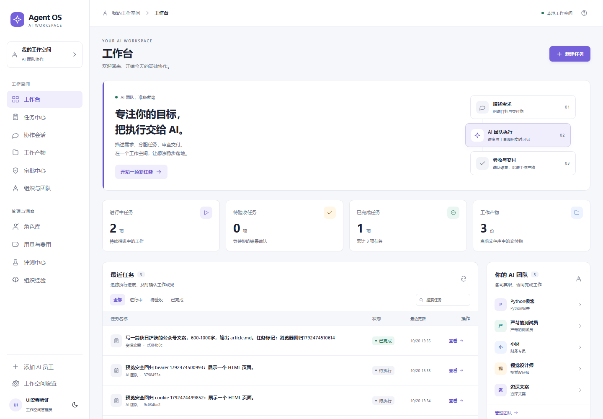
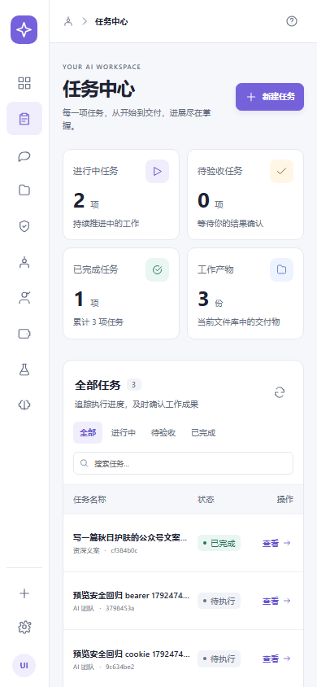
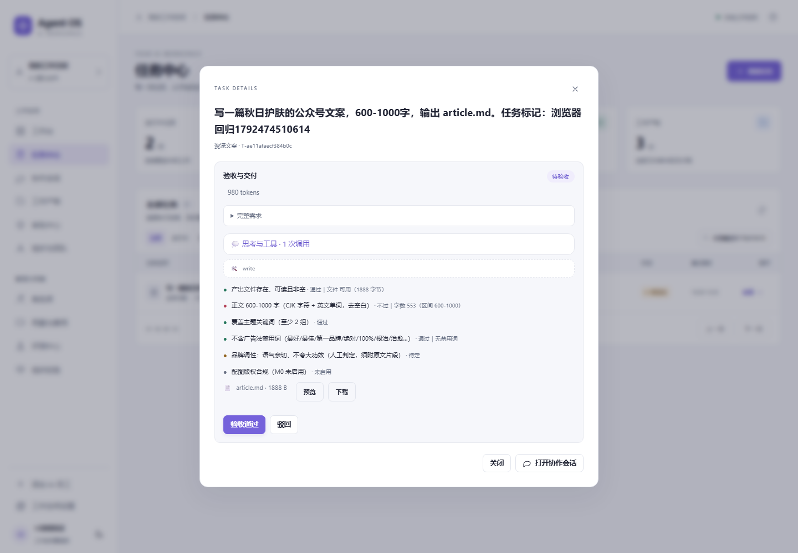
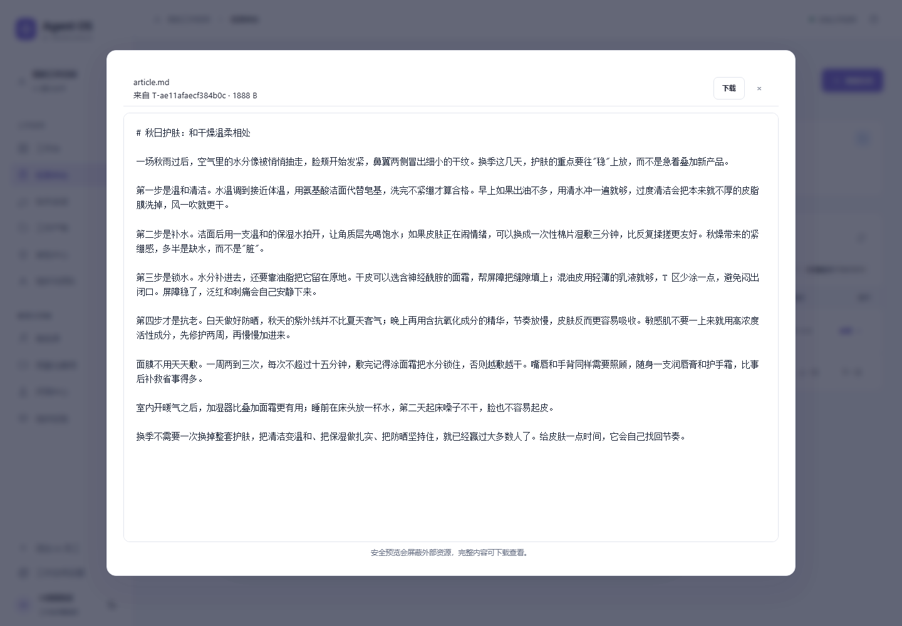

# AI 工作空间界面、真实执行与流程可靠性更新

本次更新把原先以聊天和调试信息为主的入口整理为工作台，补齐任务检索、产物检查、人工验收和失败后重试的完整操作路径。同时修复了真实 DSH 执行、任务状态、权限与产物预览中暴露的问题。前端沿用 React/Vite，后端沿用 FastAPI/SQLite；真实执行仍由独立的 DSH 子进程完成。

## 界面与操作

- **工作台成为默认首页。** 展示当前身份可见的任务统计、近期任务、AI 团队和待审批入口，并用“描述需求 → AI 执行 → 检查交付”的引导说明工作方式。统计来自后端，不使用演示数字；文件总数独立于列表分页数量。
- **新增任务中心。** 服务端执行关键词搜索、状态筛选和每页 20 条的分页；任务行的“查看”打开对应任务。请求失败有重试入口，切页错误不会把旧行标成新页，延迟返回的旧搜索结果也不会覆盖当前条件。
- **整理导航和聊天。** 保留文字导航、角色库、组织、审批、文件等入口；聊天列表仅在聊天场景展示。移动端使用会话选择器，运行详情可以收起，避免挤压正文。
- **新建任务说明执行对象。** 可以选择直接执行的 AI 员工、协作群或 CEO 调度入口。提交表单保留完整需求，显示忙碌和失败状态，并在成功后进入对应会话。
- **任务卡直接呈现进展。** 收到任务确认即可显示任务卡；后续正式卡片到达时合并，避免重复。任务状态使用中文，运行详情分别展示判据通过比例和真实 Token 数量。
- **验收、驳回和重试使用确认表单。** 驳回必须填写原因；重试允许补充说明，沿用原任务及执行会话。终态任务只显示适用操作，按钮权限以服务端返回为准。
- **改善键盘与窄屏操作。** 弹层支持 Tab 循环、Escape 和关闭后焦点恢复；附件选择按钮支持 Enter/Space；文件预览正文中按 Escape 也能关闭。覆盖 390、768、1440 px、150% 缩放和减少动态效果设置。
- **统一浅色视觉。** 重做留白、层级、卡片、表格、输入框、状态颜色和加载/错误反馈，并保留深色主题支持。

以下截图来自隔离环境中的合成任务，不包含日常工作数据：









## 真实 DSH / DeepSeek 执行

- 应用在导入执行器配置前加载本机 `.env`，让由 Web 服务拉起的 DSH 子进程取得必要环境变量。已经导出的环境变量优先，不会被 `.env` 覆盖；密钥不进入前端包。
- `UI_RUNNER=acp` 使用双向 JSON-RPC，保留用量事件、预算结算、会话继续和取消语义。`mock` / `mock_acp` 仍用于不调用模型的回归测试。
- ACP 现在显式加载 `tools/dsh-acp.patch.yml`，默认使用 `deepseek-official` provider、`deepseek-flash` 模型。其他供应商或模型需要编辑该补丁。执行器默认仍查找桌面 DSH 安装位置，也可通过 `DSH_CLI` 显式指定兼容 CLI；Windows 的 `tools/dsh-cli.cmd` 额外支持可选的相邻 `dsh-runtime` 安装，调用该包装器时会先查此目录再回退桌面安装。
- Windows 标准员工执行保留 Low 完整性级别包装及 ACP 沙箱开关；原有 `cordis` 预设的放宽执行行为保持不变，不等同于标准员工的隔离配置。沙箱测试使用独立临时目录，不依赖服务器 README 或日常任务目录。
- ACP 工具写入的相对路径按当前任务目录解析。成功执行后合并显式写入记录与目录中新产生的交付物，因此通过 Python、Shell 等命令生成的 CSV、JSON、HTML 和 README 也会进入产物列表。

真实集成验证使用了与日常数据分开的数据库和工作目录。验证任务要求以 Python 脚本为主交付，创建三行 CSV，按部门汇总工时，输出 JSON、HTML 报告及 README，并实际运行脚本断言总工时为 45。

**首次真实试验没有通过。** 含有附属 HTML 的 Python 需求被识别成网页，完整要求又被显示标题截断；生成页面中的 CSS `100%` 还触发了广告用词规则。该失败结果保留为定位依据，没有改标为成功。

修复后，另一次真实 ACP 执行交付了 `workspace_report.py`、`demo_tasks.csv`、`report.json`、`report.html` 和 `README.md`，记录了 **16,735 Token**。经代码检查后，在独立目录再次运行生成脚本，确认三组工时为 **12、25、8**，总计 **45**；五个经过认证下载的文件与原始产物 SHA-256 一致。HTML 预览、人工验收及刷新后的完成状态也经过检查。

第二次试验同时暴露了任务内 PowerShell 运行缓存被误收为交付物的问题。随后增加运行时目录排除和针对性回归，原始试验记录保留。后续权限、预览和竞态验证使用合成测试，没有重跑或改写这两次真实执行来替代证据。

## 关键缺陷修复

| 范围 | 原问题 | 更新后的行为 |
| --- | --- | --- |
| 主交付识别 | 需求包含 HTML 时，Python 主任务可能落入网页模板 | 优先识别明确的 Python/`.py` 主交付；网页里的 Python 示例仍按网页处理 |
| 需求传递 | 显示用短标题可能取代完整执行要求 | 完整需求从任务创建记录传递到执行提示；详情提供完整 requirement，列表继续使用短标题 |
| 执行提示 | 固定主文件名与用户指定名称冲突 | 尊重显式的主文件名，保留附属文件及实际运行要求；未指定时仍使用默认名称 |
| HTML 验收 | CSS 宽度 `100%` 被视为广告承诺 | HTML 禁用词检查只分析可见文本；样式、脚本、注释、属性不进入该规则，结构规则仍检查源文件 |
| 驳回 | 操作未完整落入状态与人工判据 | 保存原因、人工失败判定及审计，任务进入驳回状态 |
| 重试 | 可能丢失当前 runner、重复创建或阻塞 UI | 同任务异步提交，保留会话、递增运行序号并重置相应判据；事务约束重复点击，失败可见 |
| 停止 | 状态改变后进程可能继续，晚到成功可能覆盖取消 | 只终止服务登记的进程句柄，拒绝根据陈旧 PID 结束无关进程；停止状态优先于迟到结果 |
| 启动竞态 | 已停止的旧运行可能再次启动执行 | 在预算、进程、会话和提示生成前检查新鲜状态；正常重试和待审批后恢复保持可用 |
| 审批 | 授权范围或后续任务状态不一致 | 查询和决策要求有效身份、权限及实体范围；驳回、恢复、待审批在界面和服务端保持一致 |
| 聊天同步 | 切会话、SSE 和历史刷新可能产生旧消息、重复或跳动 | 按会话维护游标和响应归属；阅读历史时保留滚动位置；输入法确认、失败草稿和上传错误正确处理 |
| 产物列表 | 同路径重试产生重复条目，删除别名后仍可预览 | 按任务及规范路径选取当前版本；同名不同目录保持独立；删除使同任务同路径别名一同失效 |
| 产物收集 | 命令生成的附属文件缺失，或收进缓存 | 成功时合并新文件；失败时仅保留明确记录的部分交付；排除运行时、依赖、隐藏目录和逃逸路径 |

## 权限与安全边界

- 任务列表、统计、详情、操作、审批、文件下载和预览均检查当前有效身份及所需权限；按所属实体隔离可见数据。失效或撤销的身份不能继续使用旧登录凭据访问。
- 审批列表和决策遵守实体范围；普通审批者不能处理其他实体的审批。系统级全局能力需要明确权限，不通过普通身份隐式获得。
- 预览使用有效期 **120 秒**、绑定身份及单个产物的独立签名票据。iframe 不接收可复用的登录会话凭据；票据过期、产物不匹配、身份撤销或文件已删除会被拒绝。
- 预览 CSP 与 iframe 沙箱限制外部连接及外部脚本、图片、样式等资源；HTML 内联交互、文本和图片预览保留。需要依赖外部资源的完整页面可下载查看，预览中的缺失资源属于既定限制。
- 预览正文向父页面发送关闭消息时，父页面校验消息来源窗口；保留 iframe 隔离，不通过开放同源权限实现 Escape。
- 产物收集不跟随符号链接、Windows junction/reparse 路径进入外部目录，也不进入共享挂载、依赖树或运行时缓存；扫描深度、条目和文件数量都有上限。
- 自动测试使用合成身份、独立数据库和工作目录，关闭真实模型与外部消息。不把密钥、会话、个人工作数据或真实任务目录提交到仓库。

## 验证记录

本版本最终记录为：**322 项后端测试通过（1 条 warning），12 项浏览器测试通过，Vite 生产构建成功**。测试数量描述的是本次版本的运行结果，后续新增测试时以当前执行输出为准。

后端测试覆盖身份/实体范围、审批授权、任务启动与停止竞态、预算/会话继续、异步重试、完整需求、HTML 判据、产物收集/删除/访问、短期预览票据以及测试助手目录保护等行为。

12 项浏览器测试包括 10 项工作空间测试与 2 项预览安全测试，覆盖导航与布局、上传、搜索与分页故障、延迟响应、弹层焦点、预览和下载、授权审批，以及“创建 → 执行 → 检查 → 驳回 → 同任务重试 → 验收 → 刷新持久化”。预览安全测试另外通过正常登录验证 cookie 与 Bearer 路径、单文件票据及外部资源屏蔽。

真实模型验证独立于这些模拟测试；模拟测试通过不代表任意真实任务都会成功，真实任务仍需要检查交付物和验收证据。

## 维护者复现

### 构建与正常启动

在仓库根目录安装 Python 依赖，复制安全配置模板并按需填写本机配置：

```powershell
python -m venv .venv
.\.venv\Scripts\python.exe -m pip install -r requirements.txt
Copy-Item .env.example .env
.\.venv\Scripts\python.exe -c "import secrets; print(secrets.token_hex(32))"
# 将输出写入本机 .env 的 UI_SESSION_SECRET。
.\.venv\Scripts\python.exe tools/auth_admin.py issue --name ceo-local --role ceo
# 将输出的身份 ID 和 secret 保存在本机，用于登录。
npm --prefix web ci
npm --prefix web run build
.\.venv\Scripts\python.exe -m uvicorn app.main:app --host 127.0.0.1 --port 8077
```

打开 `http://127.0.0.1:8077/app/` 并使用本机已配置的身份登录。安全 `.env.example` 默认使用模拟执行，不需要真实模型密钥；真实执行前按下表调整配置。前端改动后重新 build；后端改动后重启对应服务。不要覆盖已有 `.env`。非 Windows 环境使用相应虚拟环境 Python 路径。

真实执行需要兼容的 DSH CLI、模型服务凭据和有效身份/任务预算。主要配置项如下，密钥只保存在本机配置或进程环境中：

| 配置项 | 用途 |
| --- | --- |
| `DEEPSEEK_API_KEY` | DeepSeek 官方 API 凭据；真实执行必需，模拟测试留空 |
| `DSH_CLI` | DSH CLI 入口，覆盖默认安装位置 |
| `UI_RUNNER` | Web 任务执行器；真实 ACP 用 `acp`，隔离回归用 `mock_acp` |
| `UI_TASK_BUDGET` | UI 任务预留预算，应与任务/项目授权预算一致 |
| `M0_RUN_TIMEOUT` | 单次执行超时；根据真实任务调整 |
| `DB_PATH` / `M0_WORKSPACE` | 数据库和任务目录；测试必须与日常数据分开 |
| `UI_SESSION_SECRET` | 登录会话签名配置；部署时使用独立的随机值 |
| `M0_SANDBOX` / `M0_SANDBOX_ACP` | 执行沙箱与 ACP 外层包装；Windows 验证保留 LowIL 与 ACP 包装 |

模型 provider/model 由 `tools/dsh-acp.patch.yml` 选择；切换 DSH 版本或模型前应确认该版本支持对应配置，再做独立小任务验证。不要用界面显示的模型默认值代替执行器实际配置的验证。

### 隔离浏览器测试

构建后启动专用模拟服务：

```powershell
.\.venv\Scripts\python.exe tools/serve_ui_test.py --port 8078
```

保留该进程，在另一终端使用助手打印的 `test_url` 和 `test_identity_id`：

```powershell
$env:AGENT_OS_TEST_URL = 'http://localhost:8078'
$env:AGENT_OS_TEST_ID = '<test_identity_id>'
npm --prefix web exec playwright install chromium
npm --prefix web run test:browser
```

助手复制必要代码及构建产物到新的临时目录，只在该进程启用测试登录，清空模型密钥并关闭外部集成。测试拒绝正常服务端口 8077、非 localhost 地址、缺少显式端口或配置了模型密钥的后端。显式 `--data-dir` 必须是仓库及其祖先之外的新目录或空目录；不会合并旧数据库。

Python 回归使用 `python -m pytest tests -q --disable-warnings --tb=no`，应在不包含日常 `.env`、数据库和任务目录的独立测试副本中运行，并清空真实模型凭据、关闭外部集成。浏览器助手不会自动运行 Python 测试。

更多操作说明见 [UI_WORKSPACE.md](UI_WORKSPACE.md) 与 [浏览器测试说明](../web/tests/README.md)。

## 兼容与审查重点

- 保留现有身份、SQLite 数据、任务历史、默认主文件名和非 UI 执行接口；无需为新工作台重新初始化日常数据库。
- 保留真实 runner、同任务继续执行、共享资源授权及人工验收流程；终态操作、越权访问和过期预览链接现在会明确失败。
- 文件默认直接预览保留原类型行为；嵌入预览使用额外包装提供键盘关闭，前端按新票据流程访问。旧的 `t` 查询参数传递登录凭据已被拒绝，旧客户端需要改用 cookie/Bearer 访问，或先申请单文件预览票据。
- 前端源文件与相应 `web/dist` 构建产物一并更新，锁文件记录浏览器测试依赖。审查时可以从 `web/src/Workspace.jsx`、`NewTaskModal.jsx`、`DialogAccessibility.jsx`、`app/ui/api.py`、`app/ui/admin.py`、`app/ui/approval_access.py`、`app/ui/artifacts.py` 及新增回归测试进入。
- 本说明和截图只描述可公开的合成验证与脱敏结果，不包含本机账户、服务连接信息或个人运行记录。
